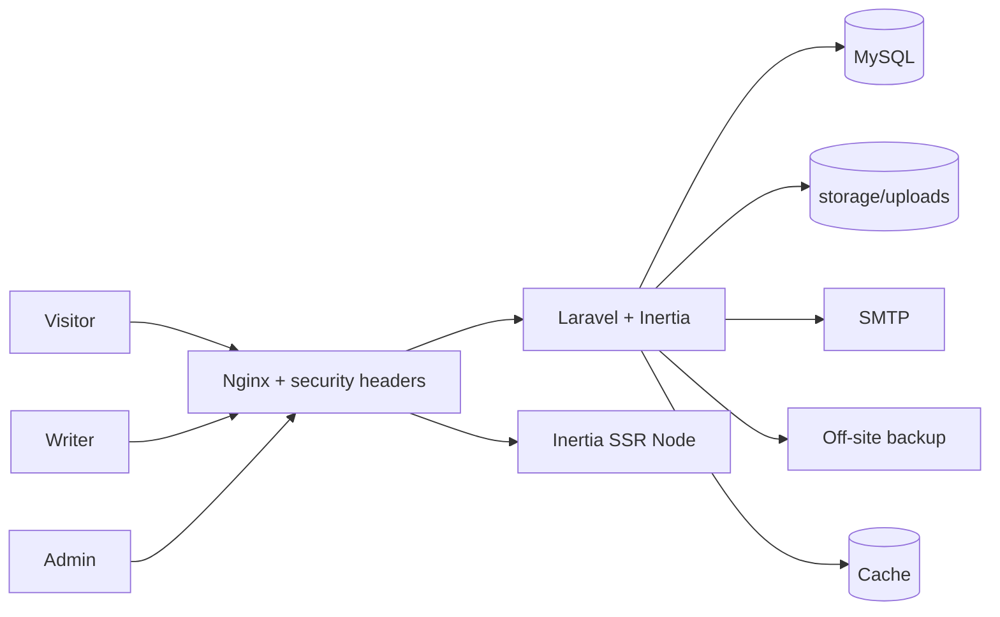
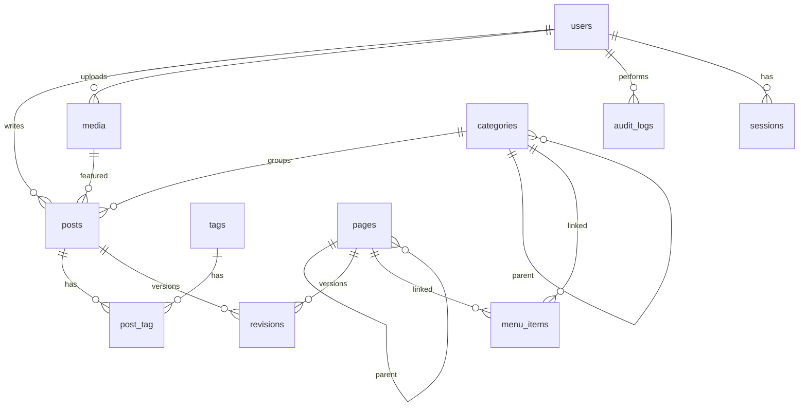

# PRD — Mini CMS

| Item | Detail |
|---|---|
| Version | 1.11 |
| Date | 2026-10-24 |
| Author | anakodok@gmail.com (generated with PRD Generator) |
| Source | docs/SA-mini-cms-2026-10-24.md |
| Status | Draft |

## 0. Assumptions, Open Questions & Changelog
**Assumptions** (semua SA-A-xx diwarisi; tambahan PRD di bawah)
- SA-A-01..SA-A-15: lihat SA Section 14 (satu bahasa ID, ≤10k post, ≤100k pageview/hari, hierarki 1 level, Writer tidak kelola Pages, upload hanya gambar, revision maks. 50, "N-1" = N+1 query).
- A-01 — Hosting = 1 VPS Linux (Nginx + PHP-FPM + Node untuk Inertia SSR + MySQL 8) karena SA-Q-04 belum dijawab; alasan: SSR butuh proses Node dan kontrol file-system read-only.
- A-02 — Role disimpan sebagai kolom enum `users.role` (admin|writer), bukan tabel `roles`; ENT-02 terpenuhi oleh enum. Alasan: hanya 2 role tetap, tabel + join tidak menambah nilai.
- A-03 — Cache & queue memakai driver `database`/`file` (tanpa Redis) pada MVP; Redis opsional bila traffic naik.
- A-04 — Editor WYSIWYG memakai TipTap (HTML output). Sanitasi server memakai HTMLPurifier (via paket Laravel). Versi paket: **verify latest stable saat P-00**.
- A-05 — Jawaban user (v1.1): SA-Q-01 PDF **ya**, ukuran dibatasi (default 10 MB, gambar tetap 5 MB). SA-Q-02 embed video **ya**, YouTube/Vimeo allowlist. SA-Q-03 Writer **boleh** membuat tag. SA-Q-04 hosting **VPS**. SA-Q-05 multi-bahasa/komentar **tidak** (Phase 2).
- A-08 — UI (admin dan elemen antarmuka publik seperti tombol, label, pesan error) **bahasa Inggris, hardcoded**; tanpa lapisan i18n. Konten (Posts/Pages) bebas bahasa apa pun (UTF-8). `<html lang>` diambil dari setting `content_language` (default `en`) dan bisa dioverride per post/page bila perlu (Phase 2). Menggantikan SA-A-01 soal bahasa; timezone tetap Asia/Jakarta.
- A-09 — Editor = WYSIWYG klasik (TipTap), bukan block editor ala Gutenberg. Alasan: permukaan serangan lebih kecil, sesuai permintaan awal; upgrade ke node/block ringan mungkin di Phase 2.
- A-10 — **Acuan desain UI admin:** `docs/design/reference-editor.jpg` (v1.3). Diadopsi: sidebar navy kiri (logo + Dashboard, Posts, Pages, Media, Team, Settings di bawah), top bar (search, avatar), area konten terang berlatar biru pucat, kartu putih rounded, aksen biru, chip untuk category/tag, toggle hijau, tab Content/Meta/SEO, panel samping kanan di editor (author, tanggal terbit, category, tag, status). Token (perkiraan visual, disetel saat implementasi): sidebar #0B2A66 / item aktif #123F8F, primary #3B82F6, latar #F4F7FC, kartu #FFFFFF, border #E3E9F3, teks #334155, muted #8A94A6, sukses #5CC98A, radius 8–12 px. Tema admin ini tetap **terang saja, tanpa dark mode** (keputusan user) dan tidak ikut palet situs F-08. Tidak diadopsi: pemilih bahasa dan "Published in English" (A-08), notifikasi bell (tidak ada fitur notifikasi in-app), "Add block" (block editor ditunda Phase 2, A-09). Blok Text dan Image pada referensi dipenuhi satu editor TipTap: teks plus node gambar `<figure><figcaption>` (caption opsional).
- A-11 — Per-post/page SEO: kolom `meta_title` (≤ 70) dan `meta_description` (≤ 160) ditambahkan di `posts` dan `pages` (tab SEO). Tab Meta berisi slug, excerpt, featured image.
- A-12 — Keputusan implementasi P-02 (v1.4): (1) Video disimpan sebagai `<div data-embed="youtube|vimeo" data-id="…">` dan baru diubah menjadi iframe ber-sandbox saat render publik (P-04); URL dari penulis tidak pernah masuk atribut `src`. (2) Sanitasi memakai `ezyang/htmlpurifier` langsung, dipasang sebagai cast `SanitizedHtml` pada kolom `body` (P-03) dan endpoint `POST /content/preview`. (3) `media.uuid` ditambahkan; PDF disimpan di disk privat dan disajikan lewat `GET /files/{uuid}` (attachment, `nosniff`, CSP sandbox), gambar di disk publik. (4) Yang butuh tabel `posts` dipindah ke P-03: FR-22 merge tag, FR-23 counter, penggantian category ke Uncategorized saat hapus (BR-18), cek "media sedang dipakai" (FR-27), sehingga TC-F04-02 dan TC-F04-05 dijalankan di P-03. (5) Pencarian di top bar admin tidak dibuat (di luar PRD).
- A-13 — Keputusan implementasi P-03 (v1.5): (1) Save dan transisi status memakai satu request: field `action` (`save|submit|publish|schedule`) pada `POST/PUT /admin/posts`; reject, unpublish, archive, unarchive, trash, restore, purge adalah endpoint tersendiri. (2) Konflik versi: Save biasa menolak versi usang dengan error validasi `version` (422, karena respons 409 tidak dipahami navigasi Inertia); autosave (JSON) membalas 409. TC-F06-08 diuji dengan kedua jalur. (3) Autosave hanya untuk draft/rejected yang sudah punya id, tanpa membuat revision (revision dibuat saat Save). (4) Waktu disimpan UTC; admin mengisi dan melihat waktu di zona browser; situs publik menampilkan `Asia/Jakarta` (`config('cms.timezone')`, P-04). (5) Admin boleh publish langsung hanya draft/rejected miliknya sendiri; draft penulis lain harus lewat review. (6) Gambar di konten hanya boleh berasal dari `/storage/uploads/…` (selain itu dibuang sanitizer). (7) Slug halaman tidak boleh memakai alamat reservasi (`config('cms.reserved_slugs')`). (8) Penjadwalan butuh cron `schedule:run` tiap menit (README).
- A-14 — Display name (v1.6): login memakai email; `users.display_name` (≤ 60, boleh kosong) adalah satu-satunya nama yang tampil ke publik (byline, RSS, JSON-LD, arsip penulis). Fallback ke `name`. Tidak boleh berisi `@` atau sama dengan email/bagian lokal email. Email dan nama asli tidak pernah dirender di halaman publik. Arsip penulis (F-09 FR-54) memakai slug yang bukan ID berurutan dan bukan username login; bentuk slug ditetapkan di P-04.
- A-15 — Acuan desain situs publik (v1.7): `docs/design/reference-public.jpg`. Header: nama/logo, menu header (huruf kapital kecil), tautan Login (atau Dashboard bila sudah login), tombol CTA opsional (Settings). Beranda: satu post unggulan besar (post terbaru, gambar penuh + kategori + judul + tanggal & waktu baca), kolom "Latest post" (4 post berikutnya dengan thumbnail), pembatas, lalu grid kartu 3 kolom "More posts" dengan paginasi bernomor. Halaman 1 memakai 5 post pertama untuk blok atas; grid dan paginasi menghitung sisanya (`posts_per_page`, 5–50, default 6). Warna dan font situs publik adalah CSS variables `--site-*` (default = palet referensi: krem #F1E5DA, putih, karat #8F3F1F) sehingga F-08 (P-05) cukup menimpa variabel. Tidak diadopsi: panah carousel "Founders corner" (diganti paginasi). Seksi bernama per kategori tidak dibuat.
- A-16 — Keputusan implementasi P-04: (1) Cache data publik per URL (TTL 10 menit) dengan "versi cache" global yang dinaikkan setiap konten/menu/setting/nama penulis berubah (tanpa cache tags, jalan di driver database). (2) Alamat: `/` beranda, `/blog`, `/blog/{slug}`, `/{slug}` halaman, `/category|tag|author/{slug}`, `/search`, `/sitemap.xml`, `/rss.xml`, `/robots.txt` (dinamis; file statis bawaan dihapus). (3) Slug lama (post/halaman/penulis) di-301 lewat tabel `redirects`. (4) `users.author_slug` dibuat dari display name. (5) `posts.reading_minutes` dihitung saat simpan (200 kata/menit, karakter CJK dihitung satu per satu). (6) Pencarian: fulltext BOOLEAN MODE dengan prefix + `LIKE` pada judul agar kueri pendek dan CJK tetap bekerja; dibatasi 60 permintaan/menit/IP dan `noindex`. (7) Mode maintenance: 503 + `Retry-After` untuk semua kecuali admin yang login; layar login tetap terbuka. (8) Pengaturan disimpan sebagai JSON mentah di tabel `settings`; sender email diterapkan ke konfigurasi mail saat boot. (9) Tautan "Visit Website" ada di top bar admin dan dashboard. (10) Halaman error 403/404/503 selalu generik; 500 generik saat APP_DEBUG mati. (11) JSON-LD Article dirender di Blade dengan `JSON_HEX_TAG` agar tidak bisa menutup tag script. (12) Header `X-Robots-Tag: noindex` untuk area admin dan layar akun.
- A-17 — Keputusan implementasi P-05 (v1.8): (1) Tema publik disajikan sebagai stylesheet terpisah `/theme.css?v=<versi cache>` (cache 1 tahun, versi berganti saat palet/font/setting berubah) dan ditautkan setelah CSS aplikasi; selektornya `html .site` agar tetap menang walau Vite menyisipkan ulang CSS aplikasi di akhir `<head>` saat runtime. (2) Peta token → variabel: background→`--site-bg`, surface→`--site-surface`, text, muted, primary, accent→`--site-soft`, border, link; `--site-on-primary` dihitung (putih atau #111 mana yang kontrasnya lebih baik); `--site-card` diturunkan dari surface + accent via `color-mix`. (3) Warna divalidasi regex hex 6/8 digit di server dan stylesheet hanya menulis nilai yang lolos; font dan ukuran harus kunci allowlist. (4) Font self-hosted lewat paket `@fontsource/*` (latin 400 dan 700) sebagai entri Vite terpisah; halaman publik hanya memuat keluarga yang dipakai tema; font sistem tidak memuat berkas apa pun. (5) Peringatan kontras WCAG AA (4.5:1) dihitung di klien (teks/surface, teks/latar, muted/surface, link/surface, teks tombol/primary) dan bersifat saran: simpan tetap boleh. (6) Maksimum 20 palet custom; satu palet aktif dijamin oleh kolom `active_flag` generated + unique index. (7) Tema admin tidak berubah (tetap terang, A-10).
- A-18 — Keputusan implementasi P-06 (v1.9): (1) CSP berbasis nonce per respons: `script-src 'self' 'nonce-…'`, tanpa `unsafe-inline`/`unsafe-eval` untuk skrip; `style-src 'self' 'nonce-…'` ditambah `style-src-attr 'unsafe-inline'` (atribut `style=""` dipakai pustaka UI); iframe hanya dari YouTube-nocookie dan Vimeo; `frame-ancestors 'none'`. Dinonaktifkan hanya bila server dev Vite berjalan (`public/hot`). Respons yang punya CSP sendiri (unduhan PDF `sandbox`) tidak ditimpa. CSS progress Inertia dimuat dari `app.css` (bukan `<style>` injeksi) agar CSP tetap ketat; nonce diteruskan ke pustaka lewat `<meta name="csp-nonce">`. Diverifikasi dengan Chrome sungguhan: 0 pelanggaran CSP di halaman publik dan admin (editor, dialog media). (2) Integritas: `cms:check-integrity` tiap 15 menit membandingkan `content_hash` konten published; email ke admin hanya saat himpunan ketidakcocokan berubah; admin dapat "confirm" (re-seal) atau memulihkan revision. (3) Lockdown: setting `lockdown` memblokir login non-admin dan memutus sesi mereka. (4) Notifikasi email: login dari browser baru (fingerprint hash User-Agent, login pertama tidak memicu), perubahan role, password, dan 2FA dimatikan; lockout sudah ada sejak P-01. (5) Backup: `cms:backup` harian 02:30 (dump `mysqldump` ter-gzip + arsip `uploads` dan `files`), retensi 14 set, disk dapat dialihkan ke off-site lewat `BACKUP_DISK`; `cms:restore --force`; gagal → email admin. (6) `cms:check-production` sebagai gerbang deploy; `docs/DEPLOY.md` berisi panduan VPS lengkap; `production-grants.sql` diperbarui (akun migrator vs app). (7) Pembatasan: admin dan editor 240 permintaan/menit/user, pencarian publik 30/menit/IP. (8) `cms:reset-2fa` untuk authenticator yang hilang.
- A-19 — F-14 Visitor Statistics (v1.10): satu tabel log mentah `page_views` (bukan rollup) dengan retensi 90 hari; laporan di-cache 60 detik. Perkiraan: 100k tayangan/hari × 90 hari ≈ 9 juta baris (~1 GB). Pelacak menambah ±3 query setelah respons (rate-limit cache + insert); dengan driver cache `database` ini terasa di trafik tinggi, gunakan Redis bila perlu. Dihitung server-side lewat `defer()` sehingga tidak menunda halaman dan tidak butuh skrip klien (CSP tetap ketat). Navigasi Inertia (XHR) dihitung sebagai tayangan.
- A-20 — F-15 (v1.11): dipilih rancangan "web hanya meminta, proses terpisah menerapkan" dibanding updater yang berjalan di proses web (gaya WordPress) karena yang terakhir mensyaratkan PHP-FPM bisa menulis seluruh kode. Tata letak server berubah menjadi `releases/ + current + shared/` (dijelaskan di `docs/DEPLOY.md`); instalasi tunggal (mis. Herd) tetap bisa melihat notifikasi tetapi tombol Update nonaktif kecuali `CMS_UPDATES=true`. Kunci penandatangan dibuat lokal; rahasia disimpan sebagai secret GitHub `RELEASE_SIGNING_KEY` dan cadangan di `~/.config/minicms/release-signing.key` pada mesin pengembang; kunci publik dipin di `release-public.key`.
- A-06 — Posts yang di-trash memakai soft delete (`deleted_at`); purge hanya Admin.
- A-07 — Konten publik di-cache per halaman (TTL 10 menit) dan di-invalidasi saat konten/tema berubah.

**Open questions:** tidak ada (SA-Q-01..05 terjawab, lihat A-05).

**Changelog:**
- v1.0 2026-10-24 — draft awal dari SA-mini-cms-2026-10-24.
- v1.1 2026-10-24 — upload PDF diizinkan (F-05), UI Inggris/konten bebas bahasa (A-08), keputusan editor WYSIWYG (A-09), Q-01..Q-05 ditutup.
- v1.2 2026-10-24 — keputusan user: block Gallery & Slider (custom TipTap node, simpan ID media, render server-side) ditunda ke **Phase 2**, bukan bagian P-00..P-06. Eksekusi dimulai.
- v1.3 2026-10-24 — acuan desain UI (A-10), kolom meta_title/meta_description (A-11), layout editor dan navigasi admin mengikuti referensi.
- v1.4 2026-10-24 — keputusan implementasi P-02 (A-12), kolom `media.uuid`.
- v1.5 2026-10-24 — keputusan implementasi P-03 (A-13).
- v1.6 2026-10-24 — display name untuk nama publik (A-14).
- v1.7 2026-10-24 — acuan desain situs publik (A-15) dan keputusan implementasi P-04 (A-16).
- v1.8 2026-10-24 — keputusan implementasi P-05 (A-17).
- v1.9 2026-10-24 — keputusan implementasi P-06 (A-18).
- v1.10 2026-10-24 — F-14 Visitor Statistics (A-19), permintaan user.
- v1.11 2026-10-24 — F-15 One-click Updates (A-20), permintaan user.

## 1. Executive Summary
Mini CMS adalah CMS satu-situs berbahasa Indonesia untuk menerbitkan Posts dan Pages, dengan taksonomi Categories dan Tags. Dua role staf (Admin, Writer) bekerja lewat editor WYSIWYG yang menghasilkan HTML aman (allowlist, disanitasi di server). Publik (tanpa akun) membaca halaman yang di-render server-side dan SEO-friendly. Admin mengatur palet warna (preset dan custom) dan font secara global. Prioritas desain: ketahanan terhadap pembobolan dan deface (defense-in-depth, revision, audit log) serta database tanpa N+1 query.

## 2. Goals, Non-Goals & Success Metrics
- **Goals:** G1 menulis tanpa HTML manual; G2 0 stored XSS lolos; G3 query halaman publik konstan; G4 pulih dari deface ≤ 5 menit; G5 ganti tema tanpa deploy.
- **Non-goals:** akun pembaca, komentar, UI multi-bahasa (i18n), multi-tenant, plugin/marketplace, theme builder penuh, e-commerce, newsletter, analitik pihak ketiga (GA/Plausible), upload dokumen selain gambar dan PDF.
- **KPI:** 100% payload XSS uji ditolak/dinetralkan; ≤ 8 query per halaman publik (home, post, arsip) untuk 10 maupun 1.000 item; TTFB cache-hit ≤ 300 ms; restore revision ≤ 3 klik.

## 3. User Personas & Roles
| Role | Deskripsi | Kebutuhan | Ringkasan permission |
|---|---|---|---|
| R-01 Admin | Pemilik/pengelola situs | Kontrol penuh, review, keamanan | CRUD semua modul, publish, tema, audit |
| R-02 Writer | Penulis | Menulis cepat, submit review | CRUD post milik sendiri (Draft/Rejected), upload media sendiri, buat tag |
| R-03 Visitor | Pembaca anonim (bukan role login) | Konten cepat & terindeks | Baca konten Published |

## 4. System Overview

**Modul:** Auth, Users, Editor, Taxonomy, Media, Posts, Pages, Appearance, Public Site, Settings/Menu, Audit, Security, Dashboard/Backup. Detail flow (login, publish, tema, baca, insiden deface) mengikuti SA FL-01..FL-06; diagram state Post ada di SA FL-02 dan menjadi aturan transisi di F-06.

## 5. Feature Specifications

### F-01 — Authentication & Account Security (Must)
- **Source:** M-01, FL-01, BR-01..05
- **User stories:** Sebagai staf, saya ingin login aman dengan 2FA agar akun tidak mudah diambil alih.
- **FR:** FR-01 login email+password; FR-02 logout & idle timeout (admin 30 mnt, writer 2 jam); FR-03 reset password via email (token sekali pakai, 60 mnt, respons selalu sama); FR-04 2FA TOTP + recovery codes (wajib Admin, setup dipaksa saat login pertama); FR-05 throttle: 5 gagal/10 mnt per akun+IP → lock 15 mnt + email, plus 10 percobaan/menit/IP; FR-06 daftar & cabut sesi aktif; FR-07 edit profil & ganti password (password min 12, cek daftar password umum, Argon2id/bcrypt).
- **Rules:** pesan error login generik; session id diregenerasi saat login; cookie HttpOnly, Secure, SameSite=Lax; akun disabled diperlakukan seperti kredensial salah.
- **UI:** halaman login, 2FA challenge, setup 2FA (QR + recovery), profil, sesi aktif. State: error generik, locked, loading.
- **API:** `POST /login`, `POST /two-factor-challenge`, `POST /logout`, `POST /forgot-password`, `POST /reset-password`, `GET/POST/DELETE /profile/sessions`, `POST /profile/two-factor`, `PUT /profile`, `PUT /profile/password` (semua guest/auth sesuai konteks).
- **Edge:** token reset dipakai dua kali → ditolak; kode TOTP replay dalam window → ditolak; ganti password mencabut sesi lain.
- **Dependencies:** F-02 (user), F-11 (audit).

### F-02 — User & Role Management (Must)
- **Source:** M-02, BR-06, BR-07
- **FR:** FR-08 list/cari user; FR-09 undang user (email berisi tautan set password, kedaluwarsa 48 jam); FR-10 ubah role; FR-11 nonaktifkan/aktifkan (cabut semua sesi); FR-12 paksa reset password + cabut sesi.
- **Rules:** satu role per user; minimal 1 Admin aktif tersisa (tolak ubah/nonaktifkan admin terakhir); user tidak bisa mengubah role sendiri; konten user nonaktif tetap ada.
- **API (admin only):** `GET/POST /admin/users`, `PUT /admin/users/{id}`, `POST /admin/users/{id}/disable|enable|force-reset`.
- **Edge:** email duplikat (case-insensitive) ditolak; undangan kedaluwarsa bisa dikirim ulang.

### F-03 — Rich Content Editor (Must)
- **Source:** M-04, BR-13..16
- **FR:** FR-13 toolbar: H2–H4, paragraf, bold, italic, underline, strike, link, ol/ul, blockquote, inline code, code block, hr, tabel, gambar, align; FR-14 undo/redo + paste dibersihkan; FR-15 mode source HTML (Admin saja); FR-16 embed YouTube/Vimeo (allowlist, iframe sandbox); FR-17 hitung kata & waktu baca; FR-18 sanitasi server-side: setiap simpan Post/Page menjalankan allowlist (BR-14), skema URL hanya http/https/mailto, link eksternal `rel="noopener noreferrer nofollow"`, atribut `on*`/`style` dibuang; render publik menyanitasi ulang bila hash tidak cocok.
- **UI:** komponen React `RichEditor` yang dipakai F-06/F-07; state: loading, error upload gambar.
- **Edge:** payload XSS (`<script>`, ``, `javascript:` href, `data:` URL, SVG skrip, `<iframe>` domain lain) harus dinetralkan; paste dari Word menghasilkan HTML bersih.
- **Dependencies:** F-05.

### F-04 — Categories & Tags (Must)
- **Source:** M-06, BR-18, BR-19
- **FR:** FR-19 CRUD category (parent 1 level, Admin); FR-20 CRUD tag (Admin), Writer bisa buat tag; FR-21 slug unik otomatis; FR-22 merge tag (Admin); FR-23 jumlah post Published per category/tag (di-cache).
- **Rules:** hapus category berisi post → post dipindah ke "Uncategorized" (kategori sistem tak bisa dihapus); nama tag unik case-insensitive; tag tanpa post tidak tampil di publik.
- **API:** `GET/POST/PUT/DELETE /admin/categories`, `/admin/tags`, `POST /admin/tags/merge`, `POST /writer/tags` (buat saja).

### F-05 — Media Library (Must)
- **Source:** M-07, BR-20..23
- **FR:** FR-24 upload gambar (jpg/png/gif/webp, ≤ 5 MB) dan PDF (≤ 10 MB), MIME dari isi file; FR-25 re-encode gambar (strip EXIF), nama file UUID, thumbnail 3 ukuran (PDF: tanpa thumbnail); FR-26 alt text wajib untuk gambar, judul wajib untuk PDF; FR-27 hapus bila tidak dipakai (Admin semua, Writer miliknya); FR-28 Writer hanya melihat media miliknya; FR-28a PDF bisa disisipkan di editor sebagai tautan unduh.
- **Rules:** folder upload tanpa eksekusi PHP; file disajikan dengan `X-Content-Type-Options: nosniff`; SVG tidak diizinkan. PDF tidak bisa di-re-encode, jadi: wajib berawalan magic `%PDF-`, disajikan dari path non-eksekusi dengan `Content-Disposition: attachment` dan `Content-Security-Policy: sandbox`, dan tidak pernah di-inline di halaman. Batas ukuran bisa diubah Admin di Settings dalam rentang 1–20 MB.
- **API:** `GET/POST /admin/media`, `PUT /admin/media/{id}`, `DELETE /admin/media/{id}`.
- **Edge:** file `.php` berekstensi `.jpg` atau `.pdf` ditolak; polyglot image dinetralkan oleh re-encode; gambar > 5 MB atau PDF > 10 MB ditolak; PDF berisi JavaScript tidak dieksekusi di origin situs karena disajikan sebagai attachment dengan CSP sandbox.

### F-06 — Posts (Must)
- **Source:** M-03, FL-02, BR-08..12
- **FR:** FR-29 CRUD post; FR-30 pilih 1 category + banyak tag; FR-31 featured image + excerpt; FR-32 slug otomatis unik, redirect 301 bila slug berubah setelah publish; FR-33 status workflow (draft → pending_review → rejected/published/scheduled → archived; trashed via soft delete); FR-34 Admin publish/jadwalkan/tolak (catatan wajib saat tolak); FR-35 scheduler memublikasikan post terjadwal ≤ 1 menit; FR-36 revision tiap simpan konten (maks 50) + restore; FR-37 autosave draft + optimistic lock (peringatan konflik); FR-38 daftar admin dengan filter status/kategori/penulis/cari, paginasi.
- **Rules:** submit butuh title, body, category; Writer hanya edit post miliknya saat Draft/Rejected; Admin yang menulis sendiri boleh publish langsung; post dalam PendingReview terkunci untuk Writer; `content_hash` dihitung tiap simpan.
- **UI/UX (acuan A-10):** halaman editor = judul besar di atas + tombol Preview dan Save (dropdown: Save draft / Submit for review / Publish sesuai role). Kartu utama bertab **Content** (editor TipTap dengan toolbar paragraf, bold, italic, list, tabel, link, code, align, gambar) / **Meta** (slug, excerpt, featured image) / **SEO** (meta title, meta description, dengan penghitung karakter). Panel kanan: Author, Post date + time, Category (chip + tombol tambah), Tag (chip + tambah), toggle status. Daftar post: tabel dengan filter dan badge status. Mobile: panel kanan turun di bawah kartu.
- **API:** `GET/POST /admin/posts`, `GET/PUT/DELETE /admin/posts/{id}`, `POST /admin/posts/{id}/submit|publish|schedule|reject|unpublish|archive|restore`, `GET /admin/posts/{id}/revisions`, `POST /admin/posts/{id}/revisions/{rev}/restore`.
- **Edge:** Writer mengakses post writer lain → 404; race dua editor → 409 dengan versi terbaru; slug bentrok ditambah sufiks.
- **Dependencies:** F-03, F-04, F-05.

### F-07 — Pages (Must)
- **Source:** M-05, FL-03, BR-17
- **FR:** FR-39 CRUD page (Admin); FR-40 parent 1 level + urutan; FR-41 status draft/published + revision (restore); FR-42 redirect saat slug berubah.
- **API:** `GET/POST/PUT/DELETE /admin/pages`, `POST /admin/pages/{id}/publish|unpublish`, revisions seperti F-06.
- **Edge:** Writer akses → 403; page punya anak tidak bisa dihapus sebelum anak dipindah.

### F-08 — Appearance: Palette & Typography (Must)
- **Source:** M-08, FL-04, BR-24..27
- **FR:** FR-43 6 preset palet (Light Classic, Dark, Ocean, Forest, Sunset, Monochrome), tak bisa diedit/dihapus; FR-44 CRUD palet custom (nama + 8 token: background, surface, text, muted, primary, accent, border, link); FR-45 validasi token = warna hex 6/8 digit saja; FR-46 live preview sebelum simpan; FR-47 peringatan kontras < 4.5:1 (teks vs background, link vs background); FR-48 satu palet aktif, tidak bisa hapus palet aktif; FR-49 font heading & body dari allowlist (System Sans, System Serif/Georgia, Monospace, Open Sans, Roboto, Lato, Merriweather, Source Serif; self-hosted) + ukuran dasar S/M/L; FR-50 reset ke default + duplikat preset.
- **Rules:** tema dirender sebagai CSS variables dari data tervalidasi di `<style nonce>`; tidak ada CSS bebas.
- **API:** `GET/POST/PUT/DELETE /admin/appearance/palettes`, `POST /admin/appearance/palettes/{id}/activate`, `PUT /admin/appearance/typography`, `POST /admin/appearance/reset`.
- **Edge:** nilai seperti `red;}body{display:none` ditolak; font di luar allowlist ditolak.

### F-09 — Public Site (SEO) (Must)
- **Source:** M-09, FL-05, BR-28..30
- **FR:** FR-51 home (post terbaru, paginasi ≤ 50); FR-52 halaman post; FR-53 halaman page; FR-54 arsip category/tag/penulis; FR-55 pencarian fulltext dengan rate limit; FR-56 meta title/description (dari `meta_title`/`meta_description`, fallback ke title/excerpt)/OpenGraph/canonical, JSON-LD Article; FR-57 `sitemap.xml`, `robots.txt`, `rss.xml`; FR-58 halaman 404/500 generik, 301 dari tabel redirects, cache halaman + invalidasi.
- **Rules:** hanya Published dan `published_at ≤ now`; SSR aktif; admin tidak diindeks (`noindex`, robots disallow `/admin`).
- **API:** `GET /`, `/{slug}` (page), `/blog/{slug}` (post), `/category/{slug}`, `/tag/{slug}`, `/author/{id}`, `/search`.
- **Query budget:** home, post, arsip ≤ 8 query (eager load author, category, tags, featured media; select kolom ringkas di list).

### F-10 — Menu & Site Settings (Should)
- **Source:** M-10
- **FR:** FR-59 nama situs, tagline, logo, favicon, `content_language` (kode bahasa untuk `<html lang>`, default `en`), batas ukuran upload PDF; FR-60 menu header/footer (page, category, URL http/https) dengan urutan; FR-61 post per halaman (5–50); FR-62 SMTP sender dan mode maintenance (Admin bypass).
- **API:** `GET/PUT /admin/settings`, `GET/PUT /admin/menus/{location}`.

### F-11 — Audit Log (Must)
- **Source:** M-11, BR-31
- **FR:** FR-63 catat login sukses/gagal/lockout/logout, perubahan role/status user, publish/unpublish/delete/restore konten, ubah tema/setting, upload/hapus media, aksi lockdown; FR-64 list + filter (user, aksi, tanggal) + ekspor CSV (Admin); FR-65 append-only (tanpa endpoint edit/hapus, DB user aplikasi hanya INSERT/SELECT pada tabel ini), retensi 12 bulan (purge via job oleh akun DB terpisah).
- **API:** `GET /admin/audit-logs`, `GET /admin/audit-logs/export`.

### F-12 — Security Hardening (Must)
- **Source:** M-12, NFR-02..12
- **FR:** FR-66 security headers: CSP berbasis nonce (tanpa `unsafe-inline`/`unsafe-eval` untuk skrip), HSTS, `frame-ancestors 'none'`, nosniff, Referrer-Policy, Permissions-Policy; FR-67 rate limiting login, reset, search, upload, API admin; FR-68 CSRF pada semua mutasi; FR-69 email notifikasi: login dari perangkat baru, perubahan role, lockout; FR-70 mode lockdown (Admin menutup login Writer dan mencabut sesi mereka); FR-71 pemeriksa integritas: job terjadwal (tiap 15 mnt) membandingkan `content_hash` Published dengan hash hasil hitung ulang dari isi; selisih → alert email Admin + entri audit.
- **Production config:** `APP_DEBUG=false`, `.env` di luar web root, kode app read-only (hanya `storage/` dan uploads writable), user DB least-privilege (tanpa DDL/FILE/SUPER), `composer audit`/`npm audit` di CI.
- **Edge:** header dicek untuk semua respons termasuk 404/500 dan aset statis.

### F-13 — Dashboard & Backup (Should)
- **Source:** M-13, RPT-01..04
- **FR:** FR-72 dashboard Admin (post per status, antrean review, aktivitas terakhir, login gagal 24 jam) dan ringkasan Writer (post milik); FR-73 backup harian DB dump + media ke lokasi off-site (konfigurabel), retensi 14; FR-74 perintah restore terdokumentasi dan diuji pada DB kosong.
- **Edge:** backup gagal → alert email Admin.

### F-14 — Visitor Statistics (Should) — ditambahkan v1.10 atas permintaan user
- **Source:** permintaan user ("hitung pengunjung dan asal link, misal IG atau WA").
- **Description:** pelacak kunjungan first-party, tanpa cookie dan tanpa menyimpan IP, dengan laporan sumber trafik dan pembuat link bertag.
- **FR:** FR-75 hitung kunjungan halaman publik (beranda, blog, post, halaman, arsip) setelah respons terkirim; FR-76 pengunjung unik per hari lewat hash HMAC(IP|UA) yang berganti tiap hari (tidak bisa dilacak lintas hari); FR-77 klasifikasi sumber: `utm_source` (alias ig/fb/wa/…), lalu header Referer (Instagram, Facebook, WhatsApp, X, Google, Bing, Telegram, TikTok, …, situs lain dengan host), lalu petunjuk User-Agent browser in-app (Instagram, Facebook, TikTok, LINE, X), selain itu "direct"; navigasi dalam situs = "internal"; FR-78 abaikan bot dan pratinjau tautan (termasuk WhatsApp/Facebook/Telegram link preview), staf yang login, DNT/GPC, prefetch, respons bukan 200, dan klien yang membanjiri (>120 kunjungan/menit); FR-79 laporan admin 7/30/90 hari: total tayangan, pengunjung unik, sumber teratas, grafik harian, sumber, konten terpopuler, kampanye, situs perujuk; klik satu konten untuk melihat asal pengunjung konten itu; FR-80 pembuat link bertag (pilih halaman + kanal + nama kampanye, salin); FR-81 pengaturan: aktif/nonaktif dan retensi 30–365 hari (default 90), penghapusan otomatis tiap malam.
- **Batasan yang dinyatakan di UI:** WhatsApp tidak mengirim Referer dan tidak punya browser in-app, jadi tautan di WhatsApp hanya terhitung "WhatsApp" bila memakai `?utm_source=whatsapp` (dibuat oleh pembuat link). Pengunjung unik dihitung per hari; total periode = jumlah pengunjung unik harian.
- **API:** `GET /admin/analytics?range=7|30|90&page_key=…` (admin).
- **Data:** tabel `page_views` (day, at, visitor BINARY(8), page_key, source, referrer_host, medium, campaign). Tidak ada IP/UA/cookie.
- **Tes:** TC-F14-01 (hitung kunjungan), TC-F14-02 (klasifikasi sumber), TC-F14-03 (bot/staf/DNT/prefetch tidak dihitung), TC-F14-04 (laporan akurat); PP-F14-01 sumber terdeteksi benar; PP-F14-02 tidak ada IP/UA/cookie tersimpan; PP-F14-03 pelacak tidak pernah merusak halaman.

### F-15 — One-click Updates (Should) — ditambahkan v1.11 atas permintaan user
- **Source:** permintaan user ("kasih fitur update juga, kalau ada versi terbaru tinggal klik, mirip WordPress").
- **Desain keamanan (keputusan utama):** aplikasi web **tidak pernah** diberi hak menulis kode sendiri (itu membatalkan NFR-03, anti-deface). Tombol hanya *meminta*; proses terpisah milik user `deploy` (`scripts/apply-update.sh`, cron tiap menit) yang menerapkan.
- **FR:** FR-82 cek rilis terbaru (GitHub Releases) harian dan manual, di-cache, tidak pernah memanggil jaringan pada request biasa; FR-83 layar Updates: versi terpasang, versi baru + catatan rilis (teks polos), badge di sidebar, email ke admin sekali per versi; FR-84 tombol Update (admin, konfirmasi) menulis `request.json` berisi hanya nomor versi, tercatat di audit log; hanya versi yang tersedia, lebih baru, dan bertanda tangan yang boleh diminta; satu permintaan sekaligus; FR-85 progres langsung (menunggu → mengunduh → verifikasi tanda tangan → backup → database → pergantian → health check) lewat `status.json`; FR-86 pengaman penerap: versi harus lebih baru, arsip diverifikasi tanda tangan Ed25519 terhadap kunci publik versi **yang sedang terpasang**, backup wajib berhasil, mode maintenance selama pergantian, migrasi dengan akun migrator, health check, **rollback kode otomatis** bila gagal, rilis lama disimpan 3 buah; FR-87 pipeline rilis: tag `vX.Y.Z` → GitHub Actions membangun arsip (vendor + aset terkompilasi, server tidak butuh Composer/Node), menandatangani, dan menerbitkan rilis; FR-88 hasil update masuk audit log dan email admin.
- **Tes:** TC-F15-01 (deteksi rilis), TC-F15-02 (email sekali per versi), TC-F15-03 (permintaan hanya menulis berkas, kode tak berubah), TC-F15-04 (tanda tangan: byte persis + kunci yang dipin), `scripts/test-updater.sh` (8 skenario end-to-end termasuk arsip dimodifikasi, kunci asing, downgrade, permintaan sampah, rollback health check). PP-F15-01 tidak ada jalur dari web ke penulisan kode; PP-F15-02 arsip tak sah ditolak dan situs tak berubah; PP-F15-03 update gagal berakhir di versi lama yang sehat.
- **Batasan:** pembaruan skema harus kompatibel mundur dengan rilis sebelumnya (rollback mengembalikan kode, bukan database; titik pulih = backup langkah 4). Rotasi kunci penandatangan belum otomatis.

## 6. Recommended Additional Features
Hanya yang dikonfirmasi lewat SA/Assumptions yang masuk Section 5 (revision, audit, redirect, media, SEO, menu/settings, backup, lockdown, autosave, fulltext). Sisanya:
| Fitur | MoSCoW | Alasan | Effort |
|---|---|---|---|
| Komentar dimoderasi | Won't (Phase 2) | Role user dihapus | L |
| Multi-bahasa | Won't (Phase 2) | Scope satu bahasa | L |
| Import WordPress | Could | Migrasi konten lama | M |
| Redis cache | Could | Bila traffic > A-02 | S |

## 7. Data Model & Database Schema

**Konvensi:** InnoDB, utf8mb4, collation `utf8mb4_0900_ai_ci` (case-insensitive). Semua tabel konten memiliki `created_at`, `updated_at`. FK `RESTRICT` kecuali disebut lain. Lazy loading dimatikan (`Model::preventLazyLoading()` non-prod) agar N+1 gagal saat test.

```sql
CREATE TABLE users (
  id BIGINT UNSIGNED AUTO_INCREMENT PRIMARY KEY,
  name VARCHAR(100) NOT NULL,
  display_name VARCHAR(60) NULL,
  author_slug VARCHAR(80) NULL UNIQUE,
  email VARCHAR(190) NOT NULL UNIQUE,
  password VARCHAR(255) NULL,
  role ENUM('admin','writer') NOT NULL DEFAULT 'writer',
  status ENUM('invited','active','disabled') NOT NULL DEFAULT 'invited',
  two_factor_secret TEXT NULL,
  two_factor_recovery_codes TEXT NULL,
  two_factor_confirmed_at TIMESTAMP NULL,
  failed_logins TINYINT UNSIGNED NOT NULL DEFAULT 0,
  locked_until TIMESTAMP NULL,
  last_login_at TIMESTAMP NULL,
  remember_token VARCHAR(100) NULL,
  created_at TIMESTAMP NULL, updated_at TIMESTAMP NULL,
  KEY users_role_status (role, status)
);

CREATE TABLE password_reset_tokens (
  email VARCHAR(190) PRIMARY KEY, token VARCHAR(255) NOT NULL, created_at TIMESTAMP NULL
);

CREATE TABLE sessions (
  id VARCHAR(255) PRIMARY KEY, user_id BIGINT UNSIGNED NULL, ip_address VARCHAR(45) NULL,
  user_agent TEXT NULL, payload LONGTEXT NOT NULL, last_activity INT NOT NULL,
  KEY sessions_user_id (user_id), KEY sessions_last_activity (last_activity),
  CONSTRAINT fk_sessions_user FOREIGN KEY (user_id) REFERENCES users(id) ON DELETE CASCADE
);

CREATE TABLE categories (
  id BIGINT UNSIGNED AUTO_INCREMENT PRIMARY KEY,
  parent_id BIGINT UNSIGNED NULL,
  name VARCHAR(100) NOT NULL, slug VARCHAR(120) NOT NULL UNIQUE,
  description VARCHAR(255) NULL, is_system TINYINT(1) NOT NULL DEFAULT 0,
  created_at TIMESTAMP NULL, updated_at TIMESTAMP NULL,
  UNIQUE KEY categories_name (name),
  KEY categories_parent (parent_id),
  CONSTRAINT fk_cat_parent FOREIGN KEY (parent_id) REFERENCES categories(id)
);

CREATE TABLE tags (
  id BIGINT UNSIGNED AUTO_INCREMENT PRIMARY KEY,
  name VARCHAR(60) NOT NULL UNIQUE, slug VARCHAR(80) NOT NULL UNIQUE,
  created_at TIMESTAMP NULL, updated_at TIMESTAMP NULL
);

CREATE TABLE media (
  id BIGINT UNSIGNED AUTO_INCREMENT PRIMARY KEY,
  uuid CHAR(36) NOT NULL UNIQUE,
  uploader_id BIGINT UNSIGNED NOT NULL,
  path VARCHAR(255) NOT NULL UNIQUE, original_name VARCHAR(255) NOT NULL,
  mime VARCHAR(50) NOT NULL, size INT UNSIGNED NOT NULL,
  width SMALLINT UNSIGNED NULL, height SMALLINT UNSIGNED NULL,
  alt_text VARCHAR(255) NULL, -- wajib untuk gambar (divalidasi di app); untuk PDF dipakai sebagai judul
  created_at TIMESTAMP NULL, updated_at TIMESTAMP NULL,
  KEY media_uploader (uploader_id, created_at),
  CONSTRAINT fk_media_user FOREIGN KEY (uploader_id) REFERENCES users(id)
);

CREATE TABLE posts (
  id BIGINT UNSIGNED AUTO_INCREMENT PRIMARY KEY,
  author_id BIGINT UNSIGNED NOT NULL,
  category_id BIGINT UNSIGNED NOT NULL,
  featured_media_id BIGINT UNSIGNED NULL,
  title VARCHAR(200) NOT NULL, slug VARCHAR(220) NOT NULL UNIQUE,
  excerpt VARCHAR(500) NULL, body MEDIUMTEXT NOT NULL,
  meta_title VARCHAR(70) NULL, meta_description VARCHAR(160) NULL,
  reading_minutes TINYINT UNSIGNED NOT NULL DEFAULT 1,
  status ENUM('draft','pending_review','rejected','scheduled','published','archived') NOT NULL DEFAULT 'draft',
  review_note VARCHAR(500) NULL,
  published_at TIMESTAMP NULL,
  content_hash CHAR(64) NOT NULL,
  version INT UNSIGNED NOT NULL DEFAULT 1,
  deleted_at TIMESTAMP NULL,
  created_at TIMESTAMP NULL, updated_at TIMESTAMP NULL,
  KEY posts_status_pub (status, published_at),
  KEY posts_cat_status_pub (category_id, status, published_at),
  KEY posts_author_status (author_id, status),
  KEY posts_deleted (deleted_at),
  FULLTEXT KEY posts_ft (title, excerpt, body),
  CONSTRAINT fk_posts_author FOREIGN KEY (author_id) REFERENCES users(id),
  CONSTRAINT fk_posts_cat FOREIGN KEY (category_id) REFERENCES categories(id),
  CONSTRAINT fk_posts_media FOREIGN KEY (featured_media_id) REFERENCES media(id) ON DELETE SET NULL
);

CREATE TABLE post_tag (
  post_id BIGINT UNSIGNED NOT NULL, tag_id BIGINT UNSIGNED NOT NULL,
  PRIMARY KEY (post_id, tag_id), KEY post_tag_tag (tag_id),
  CONSTRAINT fk_pt_post FOREIGN KEY (post_id) REFERENCES posts(id) ON DELETE CASCADE,
  CONSTRAINT fk_pt_tag FOREIGN KEY (tag_id) REFERENCES tags(id) ON DELETE CASCADE
);

CREATE TABLE pages (
  id BIGINT UNSIGNED AUTO_INCREMENT PRIMARY KEY,
  parent_id BIGINT UNSIGNED NULL,
  updated_by BIGINT UNSIGNED NOT NULL,
  title VARCHAR(200) NOT NULL, slug VARCHAR(220) NOT NULL UNIQUE,
  body MEDIUMTEXT NOT NULL,
  meta_title VARCHAR(70) NULL, meta_description VARCHAR(160) NULL,
  status ENUM('draft','published') NOT NULL DEFAULT 'draft',
  sort_order SMALLINT UNSIGNED NOT NULL DEFAULT 0,
  content_hash CHAR(64) NOT NULL,
  version INT UNSIGNED NOT NULL DEFAULT 1,
  deleted_at TIMESTAMP NULL,
  created_at TIMESTAMP NULL, updated_at TIMESTAMP NULL,
  KEY pages_status_order (status, sort_order),
  KEY pages_parent (parent_id),
  CONSTRAINT fk_pages_parent FOREIGN KEY (parent_id) REFERENCES pages(id),
  CONSTRAINT fk_pages_user FOREIGN KEY (updated_by) REFERENCES users(id)
);

CREATE TABLE revisions (
  id BIGINT UNSIGNED AUTO_INCREMENT PRIMARY KEY,
  revisionable_type ENUM('post','page') NOT NULL,
  revisionable_id BIGINT UNSIGNED NOT NULL,
  editor_id BIGINT UNSIGNED NOT NULL,
  title VARCHAR(200) NOT NULL, body MEDIUMTEXT NOT NULL,
  created_at TIMESTAMP NOT NULL DEFAULT CURRENT_TIMESTAMP,
  KEY revisions_target (revisionable_type, revisionable_id, created_at),
  CONSTRAINT fk_rev_user FOREIGN KEY (editor_id) REFERENCES users(id)
);

CREATE TABLE palettes (
  id BIGINT UNSIGNED AUTO_INCREMENT PRIMARY KEY,
  name VARCHAR(60) NOT NULL UNIQUE,
  is_preset TINYINT(1) NOT NULL DEFAULT 0,
  is_active TINYINT(1) NOT NULL DEFAULT 0,
  active_flag TINYINT GENERATED ALWAYS AS (IF(is_active=1,1,NULL)) STORED,
  tokens JSON NOT NULL,
  created_by BIGINT UNSIGNED NULL,
  created_at TIMESTAMP NULL, updated_at TIMESTAMP NULL,
  UNIQUE KEY palettes_one_active (active_flag),
  CONSTRAINT fk_pal_user FOREIGN KEY (created_by) REFERENCES users(id) ON DELETE SET NULL
);

CREATE TABLE settings (
  `key` VARCHAR(60) PRIMARY KEY, value JSON NOT NULL, updated_at TIMESTAMP NULL
);

CREATE TABLE menu_items (
  id BIGINT UNSIGNED AUTO_INCREMENT PRIMARY KEY,
  location ENUM('header','footer') NOT NULL,
  label VARCHAR(60) NOT NULL,
  type ENUM('page','category','url') NOT NULL,
  page_id BIGINT UNSIGNED NULL, category_id BIGINT UNSIGNED NULL, url VARCHAR(255) NULL,
  sort_order SMALLINT UNSIGNED NOT NULL DEFAULT 0,
  KEY menu_loc_order (location, sort_order),
  CONSTRAINT fk_menu_page FOREIGN KEY (page_id) REFERENCES pages(id) ON DELETE CASCADE,
  CONSTRAINT fk_menu_cat FOREIGN KEY (category_id) REFERENCES categories(id) ON DELETE CASCADE,
  CONSTRAINT chk_menu_target CHECK ((type='page' AND page_id IS NOT NULL) OR (type='category' AND category_id IS NOT NULL) OR (type='url' AND url IS NOT NULL))
);

CREATE TABLE redirects (
  id BIGINT UNSIGNED AUTO_INCREMENT PRIMARY KEY,
  from_path VARCHAR(255) NOT NULL UNIQUE, to_path VARCHAR(255) NOT NULL,
  status_code SMALLINT NOT NULL DEFAULT 301, created_at TIMESTAMP NULL
);

CREATE TABLE audit_logs (
  id BIGINT UNSIGNED AUTO_INCREMENT PRIMARY KEY,
  actor_id BIGINT UNSIGNED NULL,
  action VARCHAR(60) NOT NULL,
  object_type VARCHAR(30) NULL, object_id BIGINT UNSIGNED NULL,
  ip VARBINARY(16) NULL, user_agent VARCHAR(255) NULL, meta JSON NULL,
  created_at TIMESTAMP NOT NULL DEFAULT CURRENT_TIMESTAMP,
  KEY audit_created (created_at), KEY audit_actor (actor_id, created_at), KEY audit_action (action, created_at)
);
```
**Catatan:** `audit_logs` tanpa FK (log tetap utuh walau user dihapus). Seed: kategori "Uncategorized" (`is_system=1`), 6 preset palet (Light Classic aktif), settings default, 1 Admin awal via artisan command. Tabel `jobs`, `failed_jobs`, `cache` mengikuti skema bawaan Laravel.

## 8. Non-Functional Requirements
| ID | Requirement | Target terukur |
|---|---|---|
| NFR-01 | Performa publik | TTFB ≤ 300 ms (cache hit), ≤ 800 ms (miss); LCP ≤ 2.5 s; 100 concurrent user p95 < 800 ms |
| NFR-02 | Anti-XSS/SQLi | 100% payload uji (set ≥ 30 payload OWASP XSS) dinetralkan; tidak ada raw SQL berisi input; ORM binding saja |
| NFR-03 | Anti-deface | Tidak ada endpoint tulis tanpa auth+policy; revision restore ≤ 3 klik; hash check tiap 15 mnt; kode app read-only di prod; user DB tanpa DDL/FILE |
| NFR-04 | Database | ≤ 8 query per halaman publik, konstan terhadap jumlah item (test membandingkan 10 vs 500 post); admin list ≤ 10 query; lazy loading error di non-prod |
| NFR-05 | Transport | HTTPS wajib, HSTS ≥ 6 bulan, cookie Secure |
| NFR-06 | Headers | CSP nonce tanpa `unsafe-inline`/`unsafe-eval` script; skor header scanner A atau lebih |
| NFR-07 | Session/CSRF | CSRF di semua mutasi; regenerasi session saat login |
| NFR-08 | Rate limit | login 10/mnt/IP, search 30/mnt/IP, upload 20/mnt/user, 429 dengan `Retry-After` |
| NFR-09 | Secrets | tidak ada rahasia di repo; `.env.example` saja |
| NFR-10 | Dependency | `composer audit` dan `npm audit` di CI: 0 High/Critical |
| NFR-11 | Admin surface | `/admin/*` `noindex`; error auth tidak membocorkan keberadaan user |
| NFR-12 | Upload | lihat F-05; gambar ≤ 5 MB, PDF ≤ 10 MB (maks 20 MB lewat setting); ≤ 20 file/jam/user |
| NFR-13 | Retensi | audit 12 bulan; revision maks 50/konten |
| NFR-14 | Aksesibilitas/SEO | kontras AA untuk preset; alt text 100% gambar; Lighthouse SEO ≥ 90 |
| NFR-15 | Lokalisasi | UI bahasa Inggris (hardcoded); konten UTF-8 bebas bahasa (termasuk RTL/CJK tampil benar); `<html lang>` dari setting `content_language`; timezone Asia/Jakarta |
| NFR-16 | Observability | log error tanpa data sensitif; endpoint health internal |
| NFR-17 | Backup | RPO ≤ 24 jam, RTO ≤ 1 jam, restore diuji |

## 9. Recommended Tech Stack
Stack inti ditetapkan user (Laravel, React, Inertia, MySQL); versi: **verify latest stable saat P-00**.
| Layer | Pilihan | Alasan | Trade-off | Alternatif |
|---|---|---|---|---|
| Backend | Laravel (versi stabil terbaru) | Ditetapkan user; policy, rate limiter, scheduler bawaan | — | — |
| Frontend | React + Inertia + SSR | Ditetapkan user; SSR untuk SEO | Butuh proses Node di server | Blade untuk halaman publik (tanpa Node) |
| DB | MySQL 8 | Ditetapkan user; FULLTEXT + JSON | Fulltext sederhana | Meilisearch bila pencarian membesar |
| Auth | Laravel Fortify (login, reset, 2FA) | Teruji; tanpa UI bawaan, cocok Inertia | Kustom UI sendiri | Manual + pragmarx/google2fa |
| Editor | TipTap | Output HTML bersih, extensible | Perlu ekstensi tabel/embed | Lexical, Quill |
| Sanitasi | HTMLPurifier (paket Laravel) | Allowlist ketat, standar de facto | Config verbose | symfony/html-sanitizer |
| Gambar | Intervention Image | Re-encode, thumbnail | GD/Imagick wajib | Spatie Image |
| Cache/Queue | database/file (Redis opsional) | Minim infra (A-03) | Lebih lambat dari Redis | Redis |
| Storage | Disk lokal non-eksekusi + backup off-site | Sederhana | Satu server | S3-compatible |
| Test | Pest (PHP), Vitest + Testing Library (React) | Cepat, ekspresif | — | PHPUnit |
| CI | GitHub Actions: lint, test, audit | Standar | — | GitLab CI |
| Hosting | 1 VPS, Nginx, PHP-FPM, Node SSR (supervisord), HTTPS Let's Encrypt | A-01 | Single point of failure | Container/managed |
- **Environments:** local, staging, production. **CI:** PHP lint/Pint, Pest, Vitest, `composer audit`, `npm audit`, build.

## 10. Test Scenarios
Format: Given / When / Then. Tipe: P=Positive, N=Negative, E=Edge, S=Security, R=Role. Semua prioritas Must kecuali disebut.

| ID | Fitur | Tipe | Skenario | Expected |
|---|---|---|---|---|
| TC-F01-01 | F-01 | P | Given writer aktif, When login benar | Masuk dashboard, session baru, audit `login` |
| TC-F01-02 | F-01 | N | When password salah dan email tak ada | Pesan sama, tidak ada enumerasi |
| TC-F01-03 | F-01 | S | When 5 gagal beruntun | Akun lock 15 mnt, email terkirim, request ke-6 ditolak |
| TC-F01-04 | F-01 | P | Admin tanpa 2FA login pertama | Diarahkan setup 2FA, tidak bisa akses admin sebelum selesai |
| TC-F01-05 | F-01 | N | Token reset dipakai dua kali / kedaluwarsa | Ditolak |
| TC-F01-06 | F-01 | E | Ganti password | Sesi lain dicabut |
| TC-F01-07 | F-01 | S | Sesi idle > batas | Redirect login |
| TC-F02-01 | F-02 | R | Writer akses `/admin/users` | 403 |
| TC-F02-02 | F-02 | N | Admin tunggal dinonaktifkan/diturunkan | Ditolak (BR-07) |
| TC-F02-03 | F-02 | P | Admin undang user, user set password | Status active, audit tercatat |
| TC-F02-04 | F-02 | P | Disable user | Sesinya dicabut, tak bisa login |
| TC-F03-01 | F-03 | S | Simpan body berisi `<script>`, `onerror`, `javascript:`, `data:`, iframe asing | Semua dibuang/dinetralkan di server |
| TC-F03-02 | F-03 | P | Body dengan blockquote, code, pre, tabel, list | Tag allowlist tetap ada |
| TC-F03-03 | F-03 | P | Link eksternal | Mendapat `rel="noopener noreferrer nofollow"` |
| TC-F03-04 | F-03 | R | Writer kirim mode source / HTML mentah lewat API | Tetap disanitasi sama |
| TC-F03-05 | F-03 | P | Embed YouTube | Lolos dengan sandbox; domain lain dibuang |
| TC-F04-01 | F-04 | P | Admin buat category dan tag | Slug unik otomatis |
| TC-F04-02 | F-04 | N | Hapus category berisi post | Post pindah ke Uncategorized |
| TC-F04-03 | F-04 | N | Tag nama sama beda kapitalisasi | Ditolak |
| TC-F04-04 | F-04 | R | Writer buat tag baru / hapus tag | Buat OK; hapus 403 |
| TC-F04-05 | F-04 | P | Merge tag | Post tag lama pindah, tak ada duplikat |
| TC-F05-01 | F-05 | S | Upload `.php` bernama `.jpg` | Ditolak (MIME) |
| TC-F05-02 | F-05 | P | Upload png valid | Tersimpan UUID, EXIF hilang, thumbnail dibuat |
| TC-F05-03 | F-05 | N | Gambar > 5 MB, PDF > 10 MB, SVG, gambar tanpa alt | Ditolak |
| TC-F05-06 | F-05 | P | Upload PDF valid, sisipkan di post | Tersimpan UUID, tautan unduh bekerja, header attachment + CSP sandbox + nosniff |
| TC-F05-07 | F-05 | S | File non-PDF bernama `.pdf` (tanpa `%PDF-`) | Ditolak |
| TC-F05-04 | F-05 | R | Writer buka media writer lain | 404 |
| TC-F05-05 | F-05 | S | Akses `/uploads/x.php` | Tidak dieksekusi |
| TC-F06-01 | F-06 | P | Writer buat draft → submit → Admin publish | Status berurutan, tampil di publik |
| TC-F06-02 | F-06 | R | Writer coba publish langsung / edit saat PendingReview | 403 |
| TC-F06-03 | F-06 | R | Writer buka post writer lain | 404 |
| TC-F06-04 | F-06 | P | Admin tolak dengan catatan | Status rejected, Writer bisa edit lagi |
| TC-F06-05 | F-06 | P | Jadwalkan | Terbit otomatis ≤ 1 menit setelah waktu |
| TC-F06-06 | F-06 | P | Ubah slug post published | Redirect 301 dari slug lama |
| TC-F06-07 | F-06 | P | Edit 3 kali lalu restore revision | Isi kembali ke versi dipilih |
| TC-F06-08 | F-06 | E | Dua editor simpan bersamaan | Yang kedua mendapat 409 |
| TC-F06-09 | F-06 | N | Submit tanpa category/body | Validasi gagal |
| TC-F06-10 | F-06 | E | Revision ke-51 | Revision terlama dihapus |
| TC-F07-01 | F-07 | R | Writer akses pages admin | 403 |
| TC-F07-02 | F-07 | P | Admin buat page parent/child dan publish | Tampil di publik |
| TC-F07-03 | F-07 | N | Hapus page yang punya anak | Ditolak |
| TC-F08-01 | F-08 | P | Aktifkan preset Dark | Publik memakai variabel warna baru, cache di-refresh |
| TC-F08-02 | F-08 | P | Buat palet custom valid | Tersimpan, bisa diaktifkan |
| TC-F08-03 | F-08 | S | Token `red;}body{display:none` / `url(...)` | Ditolak |
| TC-F08-04 | F-08 | N | Edit/hapus preset; hapus palet aktif | Ditolak |
| TC-F08-05 | F-08 | E | Kontras teks/background < 4.5 | Peringatan muncul, simpan tetap bisa |
| TC-F08-06 | F-08 | N | Font di luar allowlist | Ditolak |
| TC-F08-07 | F-08 | R | Writer akses appearance | 403 |
| TC-F09-01 | F-09 | P | Buka home/post/arsip | Render SSR berisi konten di HTML awal |
| TC-F09-02 | F-09 | S | Buka draft/scheduled via URL langsung | 404 |
| TC-F09-03 | F-09 | P | Hitung query halaman dengan 10 vs 500 post | ≤ 8 query dan sama |
| TC-F09-04 | F-09 | P | `sitemap.xml`, `rss.xml`, `robots.txt`, meta/OG | Valid dan hanya konten Published |
| TC-F09-05 | F-09 | N | Slug tak ada / error server | 404/500 generik tanpa stack trace |
| TC-F09-06 | F-09 | P | Cari kata kunci | Hasil fulltext hanya Published; rate limit 429 jika berlebih |
| TC-F10-01 | F-10 | P | Admin ubah nama situs dan menu | Tampil di publik |
| TC-F10-02 | F-10 | N | Menu URL `javascript:` | Ditolak |
| TC-F10-03 | F-10 | P | Mode maintenance | Publik 503, Admin tetap bisa masuk |
| TC-F11-01 | F-11 | P | Login gagal, publish, ubah role | Entri audit lengkap (actor, IP, objek) |
| TC-F11-02 | F-11 | R | Writer akses audit log | 403 |
| TC-F11-03 | F-11 | S | Coba UPDATE/DELETE audit_logs dengan user DB aplikasi | Ditolak DB |
| TC-F12-01 | F-12 | S | Periksa header semua jenis respons | CSP nonce, HSTS, nosniff, frame-ancestors, referrer-policy ada |
| TC-F12-02 | F-12 | S | POST tanpa token CSRF | 419 |
| TC-F12-03 | F-12 | S | Ubah `posts.body` langsung di DB tanpa update hash | Job integritas memicu alert dan audit |
| TC-F12-04 | F-12 | P | Aktifkan lockdown | Writer tak bisa login, sesi dicabut |
| TC-F12-05 | F-12 | S | Production config | `APP_DEBUG=false`, kode tidak writable oleh user web |
| TC-F13-01 | F-13 | P | Dashboard Admin vs Writer | Data sesuai role |
| TC-F13-02 | F-13 | P | Backup lalu restore ke DB kosong | Data identik, app berjalan |
| TC-F13-03 | F-13 | N | Backup gagal | Alert email Admin |
| TC-NFR-01 | NFR | E | Load test 100 concurrent | p95 < 800 ms |
| TC-NFR-02 | NFR | S | Scan dependensi | 0 High/Critical |

## 11. Passing Points (Acceptance Criteria)
| Fitur | Passing points |
|---|---|
| F-01 | PP-F01-01 TC-F01-01..07 lulus; PP-F01-02 tidak ada enumerasi akun (respons identik); PP-F01-03 Admin wajib 2FA |
| F-02 | PP-F02-01 TC-F02-01..04 lulus; PP-F02-02 admin aktif terakhir tak bisa hilang |
| F-03 | PP-F03-01 100% payload XSS uji dinetralkan; PP-F03-02 semua tag di BR-14 bertahan; PP-F03-03 sanitasi server tidak bisa di-bypass lewat API |
| F-04 | PP-F04-01 TC-F04-01..05 lulus; PP-F04-02 tidak ada slug/nama duplikat |
| F-05 | PP-F05-01 TC-F05-01..05 lulus; PP-F05-02 tidak ada file di folder upload yang dieksekusi |
| F-06 | PP-F06-01 seluruh transisi status sesuai SA FL-02 dan transisi ilegal ditolak; PP-F06-02 isolasi data Writer terbukti; PP-F06-03 restore revision berfungsi |
| F-07 | PP-F07-01 TC-F07-01..03 lulus; PP-F07-02 revision page berfungsi |
| F-08 | PP-F08-01 TC-F08-01..07 lulus; PP-F08-02 tidak ada CSS bebas dari input; PP-F08-03 tepat satu palet aktif (dijamin constraint DB) |
| F-09 | PP-F09-01 query ≤ 8 dan konstan; PP-F09-02 hanya Published tampil; PP-F09-03 SSR terverifikasi; PP-F09-04 sitemap/RSS valid |
| F-10 | PP-F10-01 TC-F10-01..03 lulus |
| F-11 | PP-F11-01 aksi sensitif tercatat 100%; PP-F11-02 log tidak bisa diubah lewat UI/DB user aplikasi |
| F-12 | PP-F12-01 header lengkap di semua respons; PP-F12-02 pemeriksa integritas mendeteksi perubahan; PP-F12-03 lockdown berfungsi; PP-F12-04 konfigurasi production lolos checklist |
| F-13 | PP-F13-01 restore teruji ≤ 1 jam; PP-F13-02 dashboard sesuai role |

**Release DoD:** semua fitur Must lulus PP; suite Pest + Vitest hijau; coverage ≥ 70% untuk policy, sanitasi, dan alur status; 0 bug Critical/High; NFR-01..NFR-17 terpenuhi atau ditandai MANUAL CHECK; README (setup, deploy, restore) selesai.

## 12. Traceability Matrix
| Feature | Source (SA) | FR | Test Cases | Passing Points | Phase |
|---|---|---|---|---|---|
| F-01 | M-01, FL-01, BR-01..05 | FR-01..07 | TC-F01-01..07 | PP-F01-01..03 | P-01 |
| F-02 | M-02, BR-06..07 | FR-08..12 | TC-F02-01..04 | PP-F02-01..02 | P-01 |
| F-11 | M-11, BR-31 | FR-63..65 | TC-F11-01..03 | PP-F11-01..02 | P-01 |
| F-04 | M-06, BR-18..19 | FR-19..23 | TC-F04-01..05 | PP-F04-01..02 | P-02 |
| F-05 | M-07, BR-20..23 | FR-24..28 | TC-F05-01..05 | PP-F05-01..02 | P-02 |
| F-03 | M-04, BR-13..16 | FR-13..18 | TC-F03-01..05 | PP-F03-01..03 | P-02 |
| F-06 | M-03, FL-02, BR-08..12 | FR-29..38 | TC-F06-01..10 | PP-F06-01..03 | P-03 |
| F-07 | M-05, FL-03, BR-17 | FR-39..42 | TC-F07-01..03 | PP-F07-01..02 | P-03 |
| F-09 | M-09, FL-05, BR-28..30 | FR-51..58 | TC-F09-01..06 | PP-F09-01..04 | P-04 |
| F-10 | M-10 | FR-59..62 | TC-F10-01..03 | PP-F10-01 | P-04 |
| F-08 | M-08, FL-04, BR-24..27 | FR-43..50 | TC-F08-01..07 | PP-F08-01..03 | P-05 |
| F-12 | M-12, FL-06, NFR-02..12 | FR-66..71 | TC-F12-01..05 | PP-F12-01..04 | P-06 (header dasar sejak P-01) |
| F-13 | M-13, RPT-01..04 | FR-72..74 | TC-F13-01..03 | PP-F13-01..02 | P-06 |
| F-14 | (permintaan user) | FR-75..81 | TC-F14-01..04 | PP-F14-01..03 | P-07 |
| F-15 | (permintaan user) | FR-82..88 | TC-F15-01..04 + test-updater.sh | PP-F15-01..03 | P-08 |
| NFR | NFR-01..17 | — | TC-NFR-01..02 | Release DoD | P-06 |

Cakupan SA: semua modul M-01..M-13, role R-01..R-03, flow FL-01..FL-06 (FL-06 sebagai prosedur + F-12 alert), BR-01..31, ENT-01..13 (ENT-02 = enum, ENT-06 = `post_tag`), INT-01..04 (INT-04 = embed di F-03), RPT-01..04 (di F-13/F-11) tercakup.

## 13. Milestones & Phasing (execution plan)
| Phase | Nama | Features | Deliverables | Depends on | Exit criteria | Estimate |
|---|---|---|---|---|---|---|
| P-00 | Project setup | — | Laravel + React + Inertia + SSR skeleton, MySQL, Pest + Vitest, lint, CI, migrasi baseline, `preventLazyLoading`, seed Admin command | — | App boot, test runner jalan, migrasi apply, CI hijau | 1–2 hari |
| P-01 | Identitas & jejak | F-01, F-02, F-11 (+ security headers dasar F-12.66, CSRF) | Login, 2FA, reset, throttle, kelola user, audit log | P-00 | PP-F01-01..03, PP-F02-01..02, PP-F11-01..02 | 4–6 hari |
| P-02 | Taksonomi, media, editor | F-04, F-05, F-03 | CRUD category/tag, upload aman, TipTap + sanitasi | P-01 | PP-F04-01..02, PP-F05-01..02, PP-F03-01..03 | 4–6 hari |
| P-03 | Konten | F-06, F-07 | Posts + workflow + revision + scheduler, Pages | P-02 | PP-F06-01..03, PP-F07-01..02 | 5–7 hari |
| P-04 | Situs publik & pengaturan | F-09, F-10 | Halaman publik SSR, SEO, pencarian, redirect, cache, menu, settings | P-03 | PP-F09-01..04, PP-F10-01 | 4–6 hari |
| P-05 | Tampilan | F-08 | Palet preset/custom, font, preview, kontras | P-04 | PP-F08-01..03 | 3–4 hari |
| P-06 | Hardening & operasi | F-12, F-13 | CSP penuh, rate limit lengkap, hash integritas, lockdown, dashboard, backup/restore, README | P-05 | PP-F12-01..04, PP-F13-01..02, Release DoD | 3–5 hari |
MVP = P-00..P-04 (situs bisa dipakai dengan tema default); P-05 dan P-06 melengkapi. Estimasi kasar.

## 14. Risks & Mitigations
| Risiko | Kemungkinan | Dampak | Mitigasi |
|---|---|---|---|
| Sanitasi terlewat (stored XSS) | Sedang | Tinggi | Sanitasi server wajib + CSP nonce + set payload uji di CI |
| Admin account takeover | Sedang | Tinggi | 2FA wajib, lockout, notifikasi login baru, audit log |
| N+1 muncul saat fitur bertambah | Tinggi | Sedang | `preventLazyLoading` + test query-count per halaman |
| SSR menambah kompleksitas deploy | Sedang | Sedang | Supervisord + health check; fallback render klien bila SSR mati |
| Polyglot file / upload berbahaya | Rendah | Tinggi | Re-encode, MIME dari isi, folder non-eksekusi |
| Hosting belum final (SA-Q-04) | Sedang | Sedang | Asumsi VPS, dokumentasi deploy ke P-06 |
| Backup tidak teruji | Sedang | Tinggi | Tes restore wajib di PP-F13-01 |
| CSP memecah editor/embed | Sedang | Rendah | Uji CSP sejak P-02, sandbox iframe allowlist |

## 15. Glossary
Lihat SA Section 16. Tambahan: **Policy** (kelas otorisasi Laravel per model), **Eager loading** (muat relasi sekaligus), **Nonce** (token sekali per respons untuk mengizinkan inline script/style), **content_hash** (SHA-256 dari title+body untuk deteksi perubahan di luar aplikasi), **SSR** (server-side rendering).
