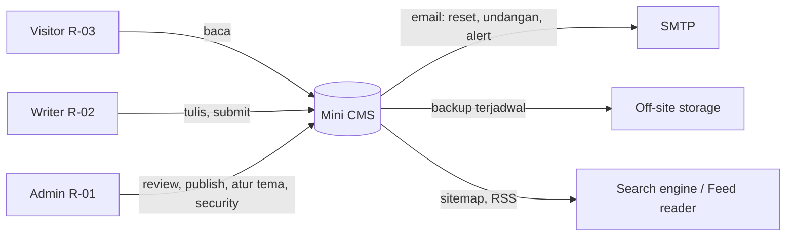
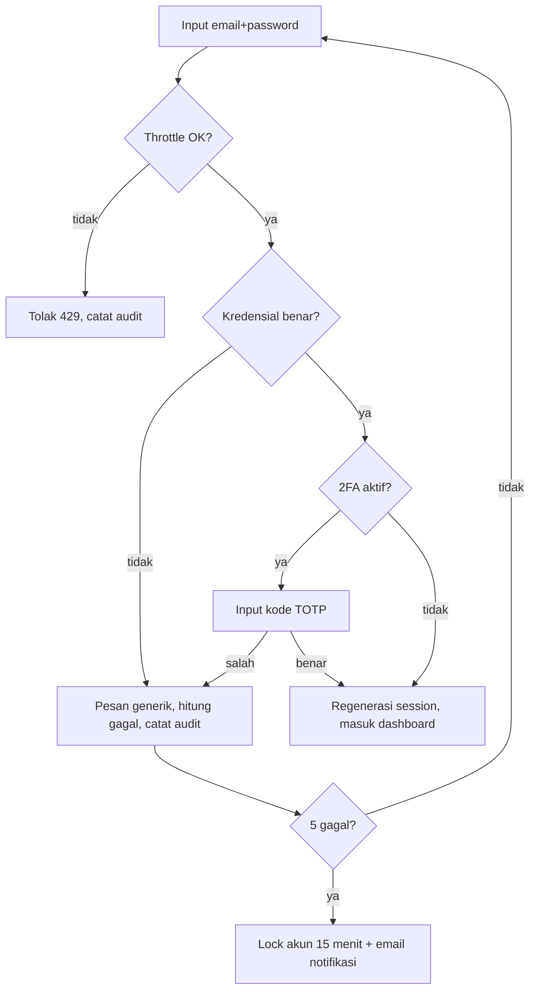
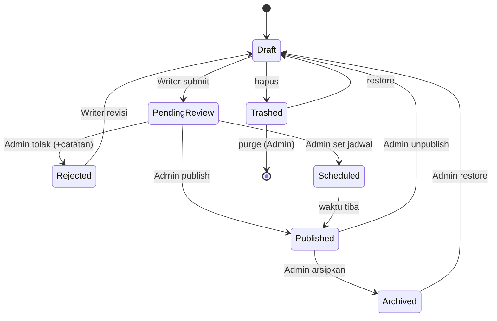
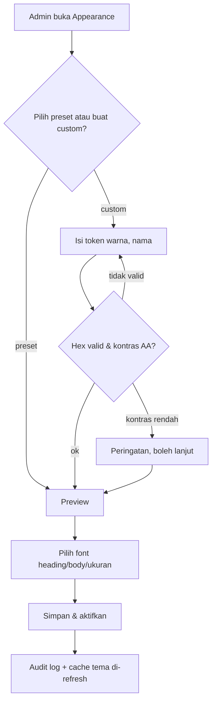
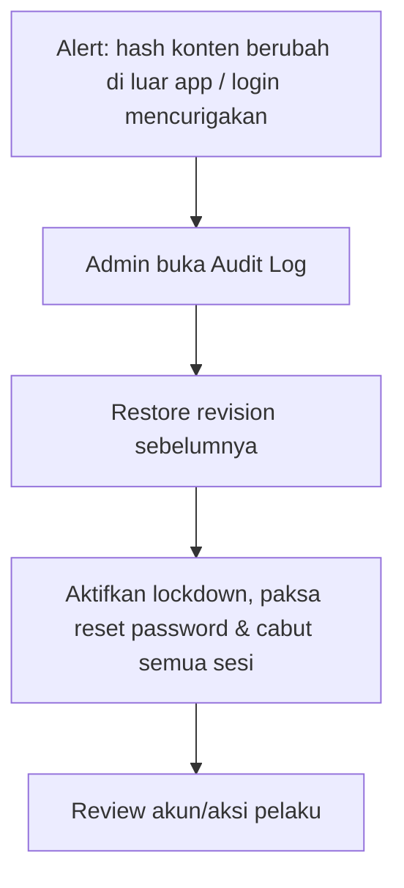
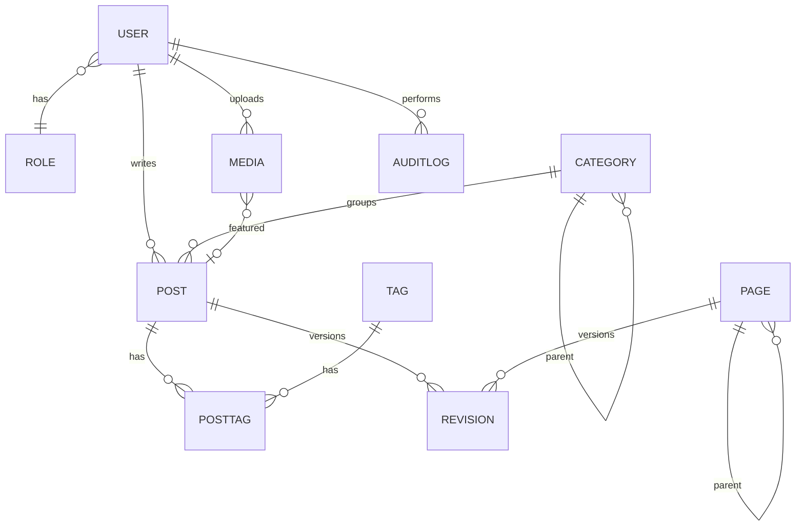

# System Analysis — Mini CMS

| Item | Detail |
|---|---|
| Document | System Analysis (SA) |
| Version | 1.0 |
| Date | 2026-10-24 |
| Prepared for | anakodok@gmail.com |
| Prepared with | system-analyst skill |
| Next step | prd-generator |
| Status | Draft (core scope confirmed, sisanya assumption) |

## 0. Summary for PRD Hand-off
- Custom CMS satu situs, satu bahasa, dengan publik yang SEO-friendly (server-rendered). Konten: Posts, Pages, Categories, Tags. Editor WYSIWYG dengan tag HTML standar CMS (`<code>`, `<blockquote>`, dll.) yang disanitasi dengan allowlist. Admin mengatur palet warna dan font secara global. Fokus utama: security (anti-deface, anti-XSS/SQLi/brute force) dan efisiensi database (tanpa N+1).
- Counts: **2 roles**, **13 modules** (Must: 10, Should: 3, Could: 0), **6 flows**.
- Blocking open questions: tidak ada (lihat Q-01..Q-05, semuanya non-blocking dengan default).
- Stack yang sudah ditetapkan user (bukan keputusan SA): Laravel, React, Inertia, MySQL.

## 1. Business Context
- **Domain:** Content Management System untuk publikasi artikel dan halaman statis.
- **Problem:** Butuh CMS sendiri yang ringan, aman, dan bisa di-custom, tanpa risiko plugin pihak ketiga seperti pada WordPress.
- **Goals & success indicators:**
  - G1: Writer bisa menulis dan men-submit post dengan editor WYSIWYG tanpa menyentuh HTML manual.
  - G2: Tidak ada stored XSS atau injeksi HTML/skrip berbahaya yang lolos (diuji dengan payload OWASP XSS cheat-sheet, 0 lolos).
  - G3: Halaman publik tidak memiliki N+1 query: jumlah query per halaman konstan (≤ 8) tidak peduli jumlah item.
  - G4: Perubahan konten tak sah bisa dideteksi dan dikembalikan ≤ 5 menit lewat revision + audit log.
  - G5: Admin bisa mengganti palet dan font situs tanpa deploy ulang.

## 2. Scale, Setup & Constraints
- Single site, single language (asumsi A-01 untuk bahasa: Indonesia).
- Pengguna internal: ±1–10 (admin + writer). Pembaca publik anonim, tanpa akun.
- Volume: hingga ±10.000 posts, ±100k pageviews/hari (A-02).
- Perangkat: desktop dan mobile browser; panel admin responsif.
- Hosting: belum ditentukan (Q-04). Wajib HTTPS.
- Compliance: UU PDP, hanya data akun staf (nama, email) sehingga minim.

## 3. Stakeholders & Roles
| ID | Role | Internal/External | Description | Main responsibilities |
|---|---|---|---|---|
| R-01 | Admin | Internal | Pemilik situs | Kelola user, review & publish, Pages, taxonomy, tampilan, setting, security, audit |
| R-02 | Writer | Internal | Penulis konten | Tulis & edit post miliknya, upload media, submit untuk review |
| R-03 | Visitor (anonim) | External | Pembaca publik, **bukan role login** | Membaca konten publik, tidak punya akun |

> Role "user" dihapus atas permintaan user (confirmed). Tidak ada registrasi publik dan tidak ada komentar.

## 4. Scope
- **In scope:** modul M-01..M-13.
- **Out of scope:** akun pembaca/registrasi publik, komentar, multi-bahasa, multi-tenant, plugin/marketplace, theme builder penuh, e-commerce, newsletter.
- **Phase 2 candidates:** komentar dimoderasi, multi-bahasa, scheduled social share, import dari WordPress.

## 5. Module Breakdown

### M-01 — Authentication & Account Security (Must)
- **Purpose:** Login aman untuk staf.
- **Sub-features:** M-01.1 login email+password; M-01.2 logout & session timeout; M-01.3 reset password via email (token sekali pakai, kedaluwarsa); M-01.4 2FA TOTP (wajib untuk Admin, opsional Writer); M-01.5 login throttling & lockout; M-01.6 kelola sesi aktif (logout dari perangkat lain); M-01.7 edit profil & ganti password.
- **Used by:** R-01, R-02 | **Flows:** FL-01 | **Entities:** ENT-01, ENT-12 | **Rules:** BR-01..BR-05
- **Source:** confirmed (security) + A-03

### M-02 — User & Role Management (Must)
- **Purpose:** Admin mengelola akun staf.
- **Sub-features:** M-02.1 CRUD user; M-02.2 set role admin/writer; M-02.3 nonaktifkan user (soft, konten tetap); M-02.4 undang user via email; M-02.5 paksa reset password.
- **Used by:** R-01 | **Entities:** ENT-01, ENT-02 | **Rules:** BR-06, BR-07
- **Source:** confirmed

### M-03 — Posts (Must)
- **Purpose:** Artikel/blog.
- **Sub-features:** M-03.1 CRUD post; M-03.2 editor WYSIWYG (M-04); M-03.3 status workflow (lihat FL-02); M-03.4 satu category utama + banyak tag; M-03.5 featured image, excerpt; M-03.6 slug otomatis & unik; M-03.7 jadwal publish; M-03.8 revision history & restore; M-03.9 autosave draft; M-03.10 daftar admin dengan filter status/kategori/penulis/pencarian.
- **Used by:** R-01, R-02, R-03 (baca) | **Flows:** FL-02, FL-05 | **Entities:** ENT-03, ENT-04, ENT-05, ENT-06, ENT-09 | **Rules:** BR-08..BR-12
- **Source:** confirmed

### M-04 — Rich Content Editor (WYSIWYG) (Must)
- **Purpose:** Editor visual yang menghasilkan HTML aman.
- **Sub-features:** M-04.1 toolbar: heading H2–H4, paragraf, bold, italic, underline, strikethrough, link, ordered/unordered list, blockquote (`<blockquote>`), inline code (`<code>`), code block (`<pre><code>`), horizontal rule, tabel, gambar (dari media library), align; M-04.2 undo/redo; M-04.3 paste dari Word/web dibersihkan; M-04.4 mode lihat source HTML (hanya Admin, tetap disanitasi); M-04.5 embed video terbatas (YouTube/Vimeo allowlist, via iframe sandbox); M-04.6 hitung kata & estimasi waktu baca.
- **Used by:** R-01, R-02 | **Rules:** BR-13..BR-16
- **Source:** confirmed (WYSIWYG + tag standar) + A-04 (daftar tag)

### M-05 — Pages (Must)
- **Purpose:** Halaman statis (About, Contact, dll.).
- **Sub-features:** M-05.1 CRUD page; M-05.2 parent-child (hierarki 1 level, A-05); M-05.3 urutan menu; M-05.4 revision; M-05.5 status Draft/Published.
- **Used by:** R-01 (kelola), R-03 (baca); Writer **tidak** (A-06) | **Entities:** ENT-07, ENT-09 | **Rules:** BR-17
- **Source:** confirmed (pages ada) + A-06

### M-06 — Categories & Tags (Must)
- **Purpose:** Taksonomi konten.
- **Sub-features:** M-06.1 CRUD category (hierarki 1 level, A-05); M-06.2 CRUD tag; M-06.3 slug unik; M-06.4 merge tag; M-06.5 halaman arsip publik per category/tag; M-06.6 jumlah post (counter ter-cache).
- **Used by:** R-01 (CRUD); R-02 (pilih, dan buat tag baru); R-03 (baca) | **Entities:** ENT-04, ENT-05, ENT-06 | **Rules:** BR-18, BR-19
- **Source:** confirmed

### M-07 — Media Library (Must)
- **Purpose:** Upload & kelola gambar/berkas.
- **Sub-features:** M-07.1 upload (validasi MIME sebenarnya, ekstensi, ukuran); M-07.2 re-encode gambar (hapus EXIF & payload tersembunyi); M-07.3 generate thumbnail/ukuran responsif; M-07.4 alt text wajib; M-07.5 hapus (cek dipakai); M-07.6 Writer hanya melihat/menghapus media miliknya.
- **Used by:** R-01, R-02 | **Entities:** ENT-08 | **Rules:** BR-20..BR-23
- **Source:** Recommended → dimasukkan Must karena editor butuh gambar

### M-08 — Appearance: Palette & Typography (Must)
- **Purpose:** Admin mengatur tampilan situs publik (global).
- **Sub-features:** M-08.1 preset palet bawaan (±6: Light Classic, Dark, Ocean, Forest, Sunset, Monochrome); M-08.2 palet custom buatan admin (nama + token warna: background, surface, text, muted, primary, accent, border, link); M-08.3 live preview sebelum disimpan; M-08.4 cek kontras WCAG AA (peringatan jika teks/background < 4.5:1); M-08.5 pilih 1 palet aktif; M-08.6 duplikat preset jadi custom; M-08.7 pilih font heading & body dari daftar terbatas (M-08.8); M-08.8 daftar font (A-07): System Sans (default), System Serif (Georgia), Monospace (untuk kode), Open Sans, Roboto, Lato, Merriweather, Source Serif; file font di-host sendiri (self-hosted), tanpa CDN; M-08.9 ukuran dasar teks (S/M/L); M-08.10 reset ke default.
- **Used by:** R-01 | **Flows:** FL-04 | **Entities:** ENT-10 | **Rules:** BR-24..BR-27
- **Source:** confirmed (palet preset + custom, font standar WordPress). Scope diubah dari per-user menjadi **global/admin only** atas pilihan user.

### M-09 — Public Site (SEO-friendly rendering) (Must)
- **Purpose:** Halaman publik yang cepat dan terindeks.
- **Sub-features:** M-09.1 home (post terbaru, paginasi); M-09.2 halaman post; M-09.3 halaman page; M-09.4 arsip category/tag/penulis; M-09.5 pencarian (fulltext); M-09.6 meta title/description/OpenGraph/canonical; M-09.7 sitemap.xml, robots.txt, RSS; M-09.8 halaman 404/500 yang aman (tanpa bocor info); M-09.9 caching halaman publik.
- **Used by:** R-03 | **Flows:** FL-05 | **Entities:** ENT-03..ENT-07 | **Rules:** BR-28..BR-30
- **Source:** confirmed (Inertia + SEO diset di wawancara)

### M-10 — Navigation Menu & Site Settings (Should)
- **Purpose:** Menu header/footer dan identitas situs.
- **Sub-features:** M-10.1 nama situs, tagline, logo, favicon; M-10.2 menu (link ke page/category/URL luar); M-10.3 jumlah post per halaman; M-10.4 SMTP/email sender; M-10.5 mode maintenance.
- **Used by:** R-01 | **Entities:** ENT-11 | **Source:** Recommended (A-08)

### M-11 — Audit Log (Must)
- **Purpose:** Jejak semua aksi sensitif, kunci untuk deteksi deface.
- **Sub-features:** M-11.1 catat login/gagal/logout, perubahan role, publish/unpublish/delete konten, ubah setting & tema, upload; M-11.2 filter & lihat (hanya Admin); M-11.3 tidak bisa diubah/dihapus dari UI; M-11.4 retensi 12 bulan.
- **Used by:** R-01 | **Entities:** ENT-12 | **Rules:** BR-31
- **Source:** Recommended → Must karena kebutuhan security

### M-12 — Security Hardening (Must)
- **Purpose:** Lapisan pertahanan menyeluruh (detail di NFR-02..NFR-12).
- **Sub-features:** M-12.1 security headers (CSP ketat, HSTS, X-Frame-Options/frame-ancestors, X-Content-Type-Options, Referrer-Policy, Permissions-Policy); M-12.2 rate limiting (login, reset password, search, upload); M-12.3 proteksi CSRF; M-12.4 sanitasi HTML di server; M-12.5 notifikasi email admin saat login dari perangkat baru atau perubahan kritikal; M-12.6 mode "lockdown" (admin bisa menonaktifkan sementara semua login writer); M-12.7 health check integritas konten (hash konten published; alert bila berubah di luar aplikasi).
- **Used by:** R-01 (monitor), sistem | **Rules:** BR-01..BR-05, BR-13..BR-16, BR-20..BR-23
- **Source:** confirmed (permintaan tidak mudah dibobol & dideface)

### M-13 — Dashboard & Backup/Restore (Should)
- **Purpose:** Ringkasan dan pemulihan.
- **Sub-features:** M-13.1 dashboard (jumlah post per status, antrean review, aktivitas terakhir); M-13.2 backup DB & media terjadwal ke lokasi terpisah (off-site); M-13.3 restore dari revision per konten.
- **Used by:** R-01 (penuh), R-02 (ringkasan miliknya) | **Source:** Recommended

## 6. RBAC (Role-Based Access Control)
Legend: C=Create, R=Read, U=Update, D=Delete, A=Approve/Publish, X=Export, — = no access, (own) = hanya milik sendiri.

| Module \ Role | R-01 Admin | R-02 Writer | R-03 Visitor |
|---|---|---|---|
| M-01 Auth & Account | CRU (semua akun, reset paksa) | RU (akun sendiri) | — |
| M-02 User & Role | CRUD | — | — |
| M-03 Posts | CRUDA | C, R/U/D (own, hanya saat Draft/Rejected), submit | R (Published) |
| M-04 Editor | penuh + source view | tanpa source view | — |
| M-05 Pages | CRUDA | — | R (Published) |
| M-06 Categories | CRUD | R | R |
| M-06 Tags | CRUD, merge | C, R | R |
| M-07 Media | CRUD (semua) | C, R/D (own) | R (yang dipakai konten publik) |
| M-08 Appearance | CRUD | — | efek tampilan saja |
| M-09 Public Site | R | R | R |
| M-10 Menu & Settings | CRU | — | — |
| M-11 Audit Log | R, X | — | — |
| M-12 Security | R/U | — | — |
| M-13 Dashboard/Backup | R, jalankan backup/restore | R (ringkasan own) | — |

- **Data scope:** Writer hanya melihat dan mengedit post dan media miliknya; tidak bisa melihat draft writer lain. Admin melihat semua.
- **Segregation of duties:** Writer tidak bisa publish (hanya submit). Admin tidak bisa menurunkan role atau menghapus akun admin terakhir (BR-07). Perubahan role/aktivasi dicatat di audit log.
- **Enforcement:** otorisasi dicek di server pada setiap request (Policy per model), bukan hanya menyembunyikan menu UI. Respons 403/404 tanpa membocorkan keberadaan resource.

## 7. System Flows

### Context diagram

### FL-01 — Login & 2FA
- Trigger: staf membuka halaman login. Actors: R-01, R-02. Precondition: akun aktif.

1. User mengisi kredensial. 2. Server cek throttle. 3. Verifikasi (pesan error tidak membedakan email salah atau password salah). 4. Jika 2FA aktif, minta kode. 5. Session id diregenerasi, audit dicatat.
- Exception: akun nonaktif → pesan generik yang sama. Admin tanpa 2FA dipaksa setup 2FA saat login pertama.

### FL-02 — Penulisan & Publikasi Post
- Actors: R-02, R-01.

1. Writer membuat post (Draft), autosave berjalan. 2. Menulis di editor; konten disanitasi saat disimpan. 3. Writer submit → PendingReview (terkunci untuk Writer). 4. Admin review: publish, jadwalkan, atau tolak dengan catatan. 5. Revision dibuat di setiap perubahan konten; slug dikunci setelah publish (perubahan slug membuat redirect, BR-12).
- Exception: Admin yang menulis sendiri bisa publish langsung (mem-bypass review). Konflik edit: peringatan jika revision berubah sejak dibuka (optimistic lock).

### FL-03 — Pengelolaan Page
Admin membuat page → Draft → Published (tanpa review). Perubahan menghasilkan revision. Unpublish mengembalikan ke Draft.

### FL-04 — Mengatur Palet & Font

1. Admin memilih/membuat palet. 2. Validasi: hanya nilai warna hex (atau rgb/hsl terstruktur), tidak ada CSS bebas. 3. Preview live. 4. Pilih font dari allowlist. 5. Simpan: situs publik langsung memakai tema baru.
- Exception: palet yang sedang aktif tidak bisa dihapus.

### FL-05 — Pembaca Membuka Konten
Visitor → URL → cek cache → (miss) ambil post + penulis + kategori + tag dalam jumlah query tetap → render server-side → kirim dengan security headers. Slug tak ditemukan atau status bukan Published → 404 generik. Slug lama → 301 ke slug baru.

### FL-06 — Respons Insiden Deface

### Document lifecycles
Post (FL-02) di atas. Page: Draft ↔ Published → Trashed. User: Invited → Active ↔ Disabled.

## 8. Business Rules
| ID | Rule | Applies to | Source |
|---|---|---|---|
| BR-01 | Password min 12 karakter, dicek terhadap daftar password bocor umum, di-hash dengan Argon2id/bcrypt | M-01 | A-03 |
| BR-02 | 5 login gagal per akun+IP dalam 10 menit → lock 15 menit; rate limit per IP 10 percobaan/menit | M-01, M-12 | confirmed (security) |
| BR-03 | 2FA wajib untuk Admin; opsional Writer | M-01 | A-03 |
| BR-04 | Session idle timeout 30 menit (admin) / 2 jam (writer); regenerasi session saat login; cookie HttpOnly, Secure, SameSite=Lax | M-01 | A-03 |
| BR-05 | Token reset password sekali pakai, kedaluwarsa 60 menit; respons "email terkirim" selalu sama | M-01 | confirmed (security) |
| BR-06 | Setiap user punya tepat satu role | M-02 | confirmed |
| BR-07 | Minimal 1 Admin aktif harus selalu ada; admin tidak bisa menonaktifkan/menurunkan diri jika ia satu-satunya | M-02 | A-09 |
| BR-08 | Hanya Admin yang dapat mengubah status ke Published/Scheduled | M-03 | confirmed |
| BR-09 | Writer hanya mengedit post miliknya saat status Draft/Rejected | M-03 | confirmed |
| BR-10 | Post wajib punya title, body, 1 category sebelum submit | M-03 | A-10 |
| BR-11 | Scheduled post dipublish otomatis maks. 1 menit setelah waktunya | M-03 | A-10 |
| BR-12 | Slug unik (per tipe); mengubah slug post yang sudah publish otomatis membuat redirect 301 | M-03, M-05 | Recommended |
| BR-13 | Semua HTML disanitasi di **server** dengan allowlist tag/atribut saat disimpan **dan** diverifikasi lagi saat render; sanitasi di klien saja tidak dianggap | M-04, M-12 | confirmed (security) |
| BR-14 | Allowlist tag: p, br, h2–h4, strong, em, u, s, a, ul, ol, li, blockquote, code, pre, hr, table/thead/tbody/tr/th/td, img, figure/figcaption, span(class terbatas). Dilarang: script, style, iframe (kecuali embed allowlist), object, embed, form, input, event handler (on*), `javascript:`/`data:` URL | M-04 | A-04 |
| BR-15 | Link eksternal otomatis `rel="noopener noreferrer nofollow"`; skema URL hanya http, https, mailto | M-04 | Recommended |
| BR-16 | Embed hanya dari domain allowlist (YouTube, Vimeo) dengan atribut sandbox | M-04 | A-04 |
| BR-17 | Page hanya dibuat/diubah oleh Admin | M-05 | A-06 |
| BR-18 | Menghapus category yang punya post ditolak, atau post dipindahkan ke "Uncategorized" | M-06 | A-11 |
| BR-19 | Nama tag unik (case-insensitive); tag tanpa post tidak ditampilkan di publik | M-06 | A-11 |
| BR-20 | Upload hanya jpg, png, gif, webp (A-12); maksimum 5 MB; MIME diverifikasi dari isi file, bukan dari ekstensi | M-07 | confirmed (security) |
| BR-21 | Nama file diganti acak (UUID); file tidak pernah dieksekusi sebagai skrip; folder upload tanpa PHP execution | M-07, M-12 | confirmed (security) |
| BR-22 | Gambar di-re-encode (strip EXIF/metadata) | M-07 | Recommended |
| BR-23 | Alt text wajib untuk gambar | M-07 | Recommended (aksesibilitas) |
| BR-24 | Warna palet divalidasi sebagai nilai warna; CSS bebas tidak diizinkan (mencegah CSS injection) | M-08 | confirmed (security) |
| BR-25 | Tema dirender sebagai CSS variables dari data tervalidasi, bukan string mentah | M-08 | Recommended |
| BR-26 | Font hanya dari allowlist yang di-host sendiri | M-08 | confirmed (font terbatas) |
| BR-27 | Tepat satu palet aktif; preset bawaan tidak dapat diedit/dihapus (hanya diduplikat) | M-08 | confirmed |
| BR-28 | Hanya konten berstatus Published dengan tanggal ≤ sekarang tampil di publik | M-09 | confirmed |
| BR-29 | Halaman daftar wajib paginasi (maks. 50 item) | M-09 | confirmed (optimasi DB) |
| BR-30 | Halaman publik tidak boleh menampilkan error detail/stack trace | M-09, M-12 | confirmed (security) |
| BR-31 | Audit log append-only; tidak ada fitur edit/hapus; berisi user, aksi, objek, IP, waktu | M-11 | Recommended |

## 9. Data Entities (conceptual)
| ID | Entity | Description | Key attributes | Relationships |
|---|---|---|---|---|
| ENT-01 | User | Akun staf | name, email, password, status, 2FA secret, last login | punya 1 Role; menulis banyak Post |
| ENT-02 | Role | Admin / Writer | name | banyak User |
| ENT-03 | Post | Artikel | title, slug, excerpt, body (HTML bersih), status, published_at, author, category, featured image | milik User, Category; punya banyak Tag, Revision |
| ENT-04 | Category | Kategori | name, slug, parent, description | banyak Post |
| ENT-05 | Tag | Label | name, slug | banyak Post (many-to-many) |
| ENT-06 | PostTag | Penghubung Post–Tag | post, tag | |
| ENT-07 | Page | Halaman statis | title, slug, body, status, parent, order | punya Revision |
| ENT-08 | Media | Berkas upload | path, mime, size, alt text, uploader, dimensi | dipakai Post/Page |
| ENT-09 | Revision | Riwayat versi konten | content snapshot, editor, created_at, target (post/page) | milik Post/Page |
| ENT-10 | Palette | Palet warna (preset/custom) | name, tokens warna, is_preset, is_active | |
| ENT-11 | Setting | Pengaturan situs (key-value) + font + menu | key, value | |
| ENT-12 | AuditLog | Jejak aksi | actor, action, object, IP, user agent, created_at | |
| ENT-13 | Redirect | Slug lama → baru | from, to, type | |

**Catatan optimasi data (analisis, bukan DDL):**
- Semua list relasi (post → author, category, tags, media) harus dimuat dengan eager loading/join dalam jumlah query konstan; lazy loading dilarang di mode non-produksi agar N+1 langsung error saat dev/test (NFR-04).
- Kolom yang sering difilter/diurutkan butuh index: status+published_at, slug (unique), category, author, FK tabel pivot.
- Counter (jumlah post per category/tag) disimpan/di-cache, bukan dihitung per baris.
- Pencarian memakai fulltext index, bukan `LIKE '%…%'`.
- Hanya kolom yang dibutuhkan yang di-select di list (tanpa `body` penuh di daftar).

## 10. Integrations
| ID | System | Direction | Data exchanged | Frequency | Priority |
|---|---|---|---|---|---|
| INT-01 | SMTP / email provider | out | Reset password, undangan, alert keamanan | Event-driven | Must |
| INT-02 | Off-site backup storage | out | Dump DB + media | Harian | Should |
| INT-03 | Search engine (sitemap/robots) / RSS | out | sitemap.xml, feed | On-demand, di-cache | Must |
| INT-04 | Embed video (YouTube/Vimeo) | in (render) | iframe allowlist | Saat dibaca | Could (opsional, A-04) |

## 11. Reports & KPIs
| ID | Report / KPI | Audience | Frequency | Filters | Notes |
|---|---|---|---|---|---|
| RPT-01 | Post per status & antrean review | R-01 | Real-time | status, penulis | Dashboard |
| RPT-02 | Produktivitas penulis (jumlah post published) | R-01 | Bulanan | periode, penulis | |
| RPT-03 | Audit log | R-01 | On-demand | user, aksi, tanggal | Ekspor CSV |
| RPT-04 | Login gagal / lockout | R-01 | Harian | periode, IP | Indikator serangan |

> Analitik pengunjung (pageview) tidak dibuat bawaan; gunakan layanan eksternal bila perlu (A-13).

## 12. Non-Functional Needs
- **NFR-01 Performance:** halaman publik TTFB ≤ 300 ms (cache hit), ≤ 800 ms (cache miss) pada 100k pageview/hari; LCP ≤ 2.5 s.
- **NFR-02 Anti-XSS/Injection:** sanitasi HTML server-side dengan allowlist (BR-13..16); semua query lewat query builder/ORM ber-parameter; tidak ada SQL mentah dari input; mass-assignment dilindungi; output di-escape secara default.
- **NFR-03 Anti-deface:**
  - Tidak ada jalur menulis konten tanpa autentikasi + otorisasi.
  - Revision untuk semua perubahan konten; restore satu klik.
  - Hash integritas konten Published, alert bila berubah di luar aplikasi (M-12.7).
  - File aplikasi read-only di production (hanya `storage`/`uploads` writable) dan user DB aplikasi least-privilege (tanpa hak DDL/FILE).
  - Folder upload tidak mengeksekusi skrip.
  - Audit log + notifikasi aksi kritikal.
  - Backup off-site terjadwal dan teruji restore.
- **NFR-04 Database:** tanpa N+1; jumlah query per halaman publik ≤ 8 dan konstan terhadap jumlah item; ada test otomatis yang memverifikasinya; paginasi wajib; index sesuai pola query; eager load dipaksa (lazy loading dicegah di non-prod).
- **NFR-05 Transport:** HTTPS wajib, HSTS, cookie Secure.
- **NFR-06 Headers:** CSP ketat (tanpa `unsafe-inline` skrip; gunakan nonce), X-Content-Type-Options, frame-ancestors 'none' untuk admin, Referrer-Policy, Permissions-Policy. Font self-hosted agar CSP tetap ketat.
- **NFR-07 CSRF & session:** token CSRF pada semua request mutasi; session fixation dicegah (BR-04).
- **NFR-08 Rate limiting:** login, reset, search, upload, dan API admin (BR-02).
- **NFR-09 Secrets & config:** `.env` di luar web root, debug mode mati di production, tidak ada kredensial di repo.
- **NFR-10 Dependency hygiene:** audit dependensi (composer/npm) terjadwal dan versi terkunci; tanpa plugin pihak ketiga yang tak diperlukan.
- **NFR-11 Admin surface:** panel admin dipisah path (`/admin`), tidak diindeks (`noindex`), tanpa enumerasi user lewat pesan error.
- **NFR-12 Upload safety:** lihat BR-20..BR-23; batas ukuran dan jumlah per user.
- **NFR-13 Audit & retensi:** audit log 12 bulan; revision disimpan maks. 50 versi per konten (A-14).
- **NFR-14 Accessibility & SEO:** kontras AA, alt text, markup semantik, meta lengkap, sitemap; Inertia dengan SSR agar konten terbaca crawler.
- **NFR-15 Localization:** bahasa Indonesia, timezone Asia/Jakarta (A-01).
- **NFR-16 Observability:** log error terpusat tanpa data sensitif; health check endpoint internal.
- **NFR-17 Kompatibilitas:** dua versi terbaru Chrome, Firefox, Safari, Edge; admin responsif ≥ 360 px.

## 13. Recommended Additions
Fitur yang tidak diminta eksplisit tapi sebaiknya ada (belum dikonfirmasi user):
| Fitur | Prioritas | Alasan |
|---|---|---|
| Revision history & restore | Must | Inti pemulihan setelah deface (sudah masuk M-03.8) |
| Audit log | Must | Deteksi & forensik (M-11) |
| 2FA + lockout | Must | Akun admin adalah target utama deface (M-01) |
| Media library | Must | Editor butuh gambar |
| Redirect otomatis saat slug berubah | Should | Menjaga SEO dan tautan lama |
| SEO: meta, sitemap, RSS | Must | Publik SEO-friendly |
| Menu & site settings | Should | Identitas situs |
| Backup off-site + uji restore | Should | Pemulihan bencana |
| Mode maintenance | Should | Update aman |
| Autosave & peringatan konflik edit | Should | Cegah kehilangan tulisan |
| Pencarian fulltext | Should | Pengalaman pembaca |
| Dark mode otomatis (via palet Dark) | Could | Sudah tercakup di preset |
| Komentar dimoderasi | Could (Phase 2) | Dikeluarkan sementara karena role user dihapus |
| Schedule publish | Should | Sudah ada (M-03.7) |

## 14. Assumptions & Open Questions
**Assumptions**
- A-01 — Satu bahasa (Indonesia), timezone Asia/Jakarta — karena jawaban "satu situs".
- A-02 — Skala ≤ 10.000 post, ≤ 100k pageview/hari — default umum blog.
- A-03 — Kebijakan password/2FA/session (BR-01, 03, 04) adalah rekomendasi keamanan, belum dikonfirmasi angka detailnya.
- A-04 — Daftar tag HTML yang diizinkan (BR-14) dan embed video allowlist (BR-16) adalah interpretasi "tag standar CMS".
- A-05 — Hierarki category dan page maksimum 1 level (parent-child) supaya query sederhana.
- A-06 — Writer tidak boleh mengelola Pages (hanya Admin).
- A-07 — Daftar font: System Sans, System Serif (Georgia), Monospace, Open Sans, Roboto, Lato, Merriweather, Source Serif. Diasumsikan sesuai "font standar WordPress"; di-host sendiri.
- A-08 — Menu & site settings masuk scope walau tidak diminta.
- A-09 — Admin terakhir tidak boleh dihapus/diturunkan.
- A-10 — Aturan validasi submit dan penjadwalan (BR-10, 11) default.
- A-11 — Aturan penghapusan category/tag (BR-18, 19) default.
- A-12 — Upload hanya gambar; dokumen (PDF) belum diizinkan.
- A-13 — Tidak ada analitik pengunjung bawaan.
- A-14 — Revision dibatasi 50 per konten.
- A-15 — "Hindari N-1" diartikan **N+1 query problem**.

**Open questions (semua non-blocking, memakai default di atas)**
- Q-01 — Perlu upload PDF/dokumen? Memblokir: BR-20 (default: tidak).
- Q-02 — Perlu embed video (YouTube/Vimeo)? Memblokir: M-04.5 (default: ya, allowlist).
- Q-03 — Apakah Writer boleh membuat tag baru atau hanya memilih? Memblokir: M-06 (default: boleh membuat).
- Q-04 — Hosting apa (shared hosting / VPS / container)? Memblokir: detail anti-deface file-system read-only, backup, dan SSR (Inertia SSR butuh proses Node). Default: VPS.
- Q-05 — Apakah ada kebutuhan multi-bahasa/komentar di masa depan? Memblokir: desain skema (default: tidak, Phase 2).

## 15. Interview Log
| Round | Topic | Question | User answer |
|---|---|---|---|
| 0 | Brief awal | Permintaan CMS: Laravel+React+Inertia+MySQL, WYSIWYG + tag HTML standar, security/anti-deface, RBAC admin/writer/user, posts/pages/tags/categories, hindari N+1, palet warna (preset + custom), font standar WordPress | (dari prompt) |
| 1 | Role user | Siapa 'user' dan bisa apa? | "hilangkan user, cukup admin dan writer" |
| 1 | Scope tema | Palet & font berlaku untuk siapa? | Global saja (admin yang atur) |
| 1 | Workflow | Alur publish tulisan? | Writer submit, admin review lalu publish |
| 1 | Setup & SEO | Setup situs? | Satu situs, SEO-friendly (SSR) |

## 16. Glossary
- **WYSIWYG:** editor visual; tampilan saat menulis ≈ hasil akhir.
- **Allowlist sanitization:** hanya tag/atribut yang disebutkan yang lolos, sisanya dibuang.
- **XSS:** injeksi skrip lewat konten; **stored XSS** tersimpan di DB dan menyerang pembaca.
- **CSP:** Content-Security-Policy, header yang membatasi sumber skrip/gaya yang boleh jalan.
- **CSRF:** pemalsuan request atas nama user yang sedang login.
- **Deface:** perubahan tampilan/konten situs tanpa izin oleh penyerang.
- **N+1 query:** 1 query list + N query tambahan per baris untuk relasi; diatasi dengan eager loading.
- **Eager loading:** memuat relasi sekaligus dalam jumlah query tetap.
- **Revision:** snapshot versi konten untuk riwayat dan restore.
- **TOTP/2FA:** kode sekali pakai 6 digit dari aplikasi authenticator.
- **SSR:** server-side rendering, HTML lengkap dari server agar bisa diindeks crawler.
- **Palette token:** nama peran warna (primary, background, dst.) yang diisi nilai warna.
